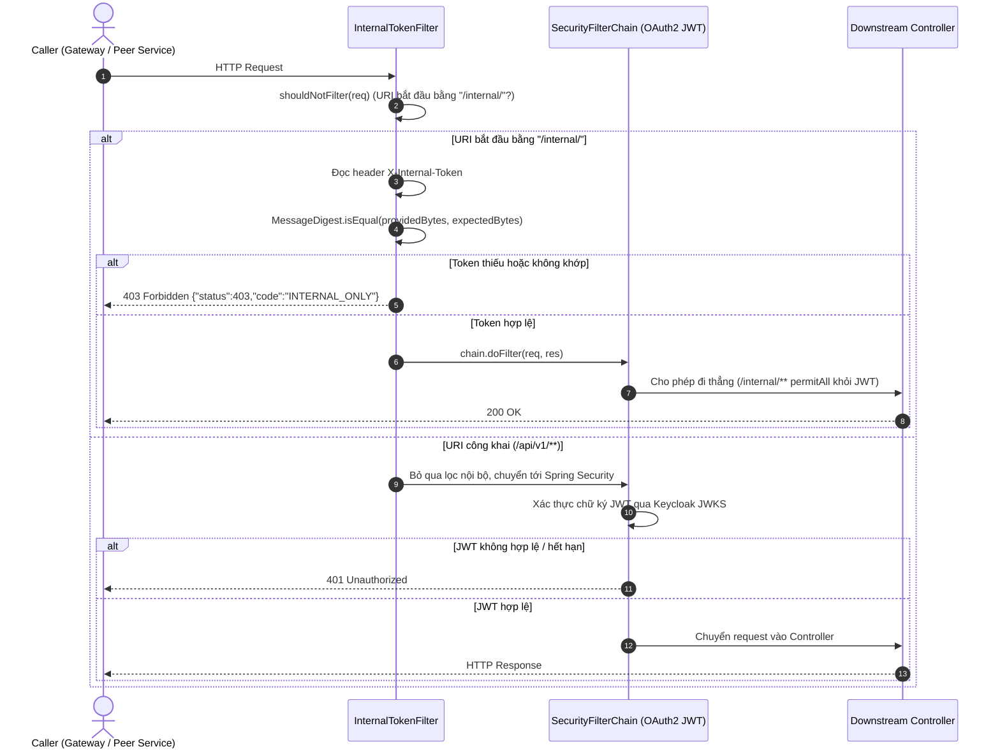
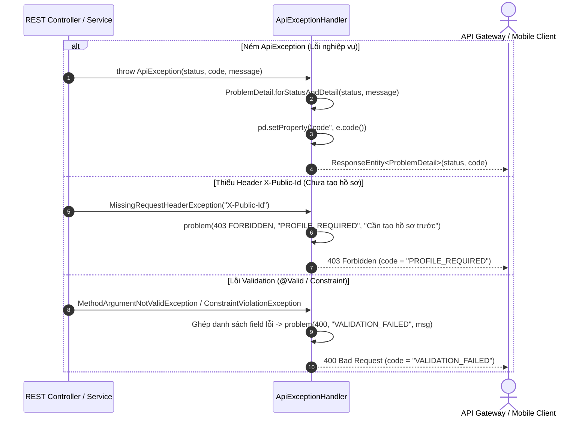
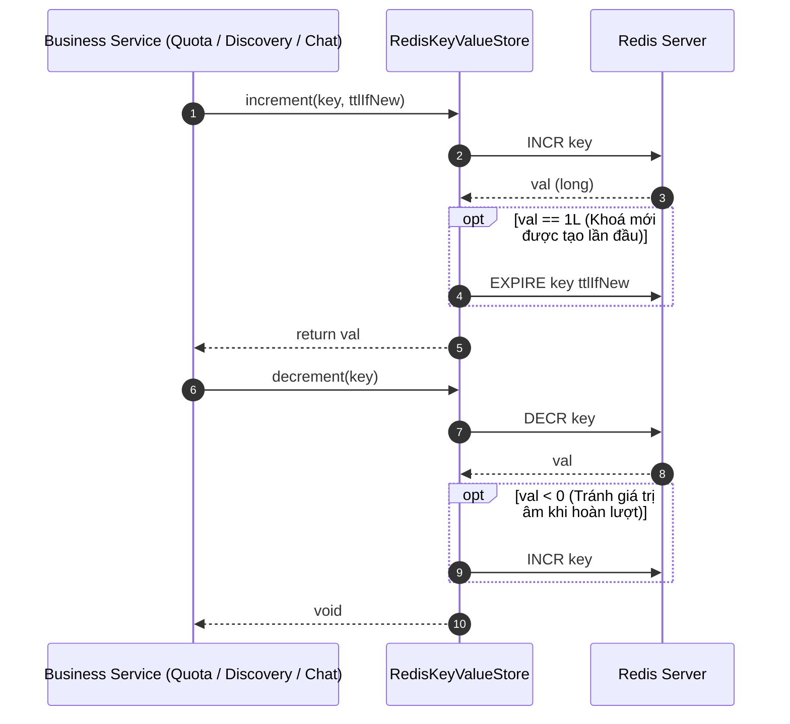
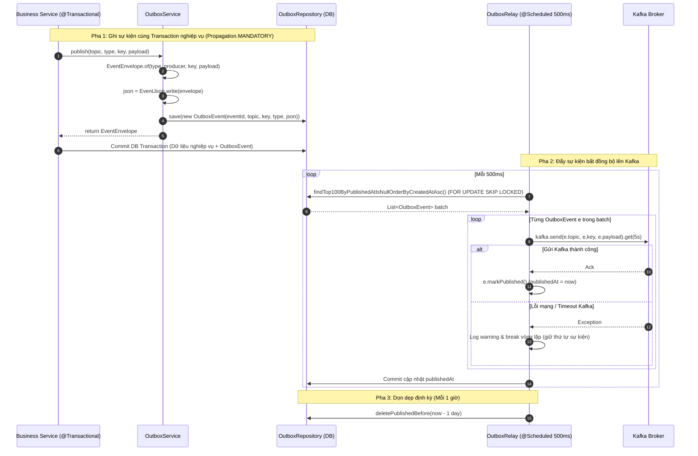
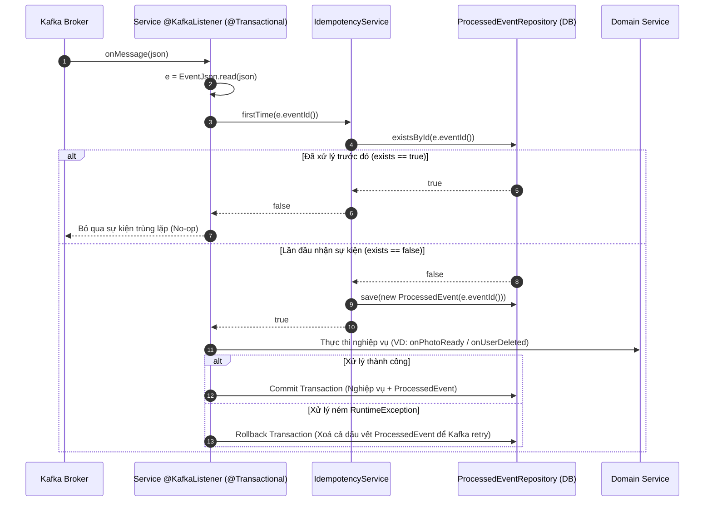
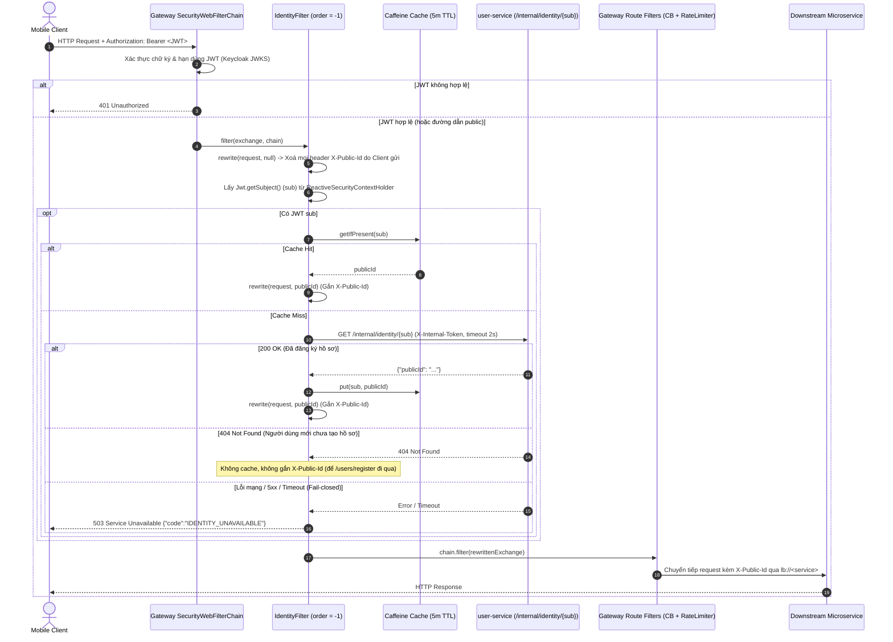
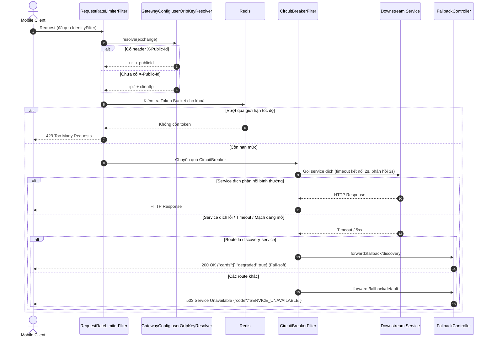

# 01. Kiến trúc Thư viện Dùng chung (`libs/`) & Tầng Hạ tầng (`infra/`)

Tài liệu này mô tả chi tiết thiết kế lớp (Class Diagram có comment) và sơ đồ tuần tự (Sequence Diagram theo từng class) cho:
1. **`libs/common`** (`com.animallocket.common.*`): Định nghĩa hằng số, phong bì sự kiện Kafka (`EventEnvelope`), kho khoá-giá trị (`KeyValueStore`), chuẩn hoá lỗi RFC 7807 (`ApiException`, `ApiExceptionHandler`), bảo mật nội bộ (`InternalTokenFilter`, `CommonAutoConfiguration`), tự cấu hình Kafka DLQ và Resilience4j.
2. **`libs/outbox-jpa`** (`com.animallocket.outbox.*`): Mẫu thiết kế Transactional Outbox (`OutboxEvent`, `OutboxService`, `OutboxRelay`, `OutboxMetrics`) và khử trùng lặp sự kiện phía Consumer (`ProcessedEvent`, `IdempotencyService`).
3. **`infra/api-gateway`** (`com.animallocket.gateway.*`), **`infra/config-server`**, **`infra/eureka-server`**.

---

## Phần 1: `libs/common`

### 1.1 Class Diagram (`libs/common`)

```mermaid
classDiagram
    direction TB

    %% ==========================================
    %% Hằng số & Tiện ích Định danh (Constants & IDs)
    %% ==========================================
    class Headers {
        <<final>>
        +String PUBLIC_ID = "X-Public-Id"$
        +String INTERNAL_TOKEN = "X-Internal-Token"$
        +String CORRELATION_ID = "X-Correlation-Id"$
        +String IDEMPOTENCY_KEY = "Idempotency-Key"$
    }
    note for Headers "Chứa tên các HTTP Header chuẩn dùng xuyên suốt Gateway và các Microservices.\nClient tuyệt đối không được tự truyền X-Public-Id."

    class Topics {
        <<final>>
        +String USER = "user.events"$
        +String FRIEND = "friend.events"$
        +String MEDIA = "media.events"$
        +String POST = "post.events"$
        +String CHAT = "chat.events"$
        +String BILLING = "billing.events"$
        +String MEDIA_RESULTS = "media.results"$
        +String MEDIA_DLQ = "media.events.dlq"$
    }
    note for Topics "Danh mục tên các Kafka Topic chuẩn trong toàn hệ thống."

    class EventTypes {
        <<final>>
        +String USER_REGISTERED$
        +String USER_DELETED$
        +String USER_BLOCKED$
        +String LEAD_ANIMAL_CHANGED$
        +String FRIEND_REQUEST_RECEIVED$
        +String FRIEND_ACCEPTED$
        +String FRIEND_REMOVED$
        +String DISCOVERY_DISABLED$
        +String PHOTO_UPLOADED$
        +String PHOTO_READY$
        +String PHOTO_REJECTED$
        +String FACE_PROCESSED$
        +String FACE_FAILED$
        +String POST_PUBLISHED$
        +String POST_LIKED$
        +String POST_COMMENTED$
        +String MESSAGE_SENT$
        +String SUBSCRIPTION_ACTIVATED$
        +String SUBSCRIPTION_EXPIRED$
        +String CONSUMABLE_GRANTED$
    }
    note for EventTypes "Danh sách toàn bộ mã loại sự kiện (Event Type) phát qua Kafka."

    class PublicIds {
        <<final>>
        -char[] ALPHABET$
        -int LENGTH = 20$
        -Pattern VALID$
        -SecureRandom RANDOM$
        +generate()$ String
        +isValid(String value)$ boolean
    }
    note for PublicIds "Sinh và kiểm tra mã định danh ẩn danh publicId dài 20 ký tự base32 [a-z2-7].\nĐảm bảo không thể đoán tuần tự và không lộ sub của Keycloak."

    %% ==========================================
    %% Phong bì Sự kiện (Event Envelope & JSON)
    %% ==========================================
    class EventEnvelope {
        <<record>>
        +String eventId
        +String type
        +int version
        +Instant occurredAt
        +String producer
        +String correlationId
        +String key
        +JsonNode payload
        +of(String type, String producer, String key, Object payload)$ EventEnvelope
        +payloadAs(Class~T~ clazz) T
    }
    note for EventEnvelope "Phong bì chuẩn bọc mọi thông điệp Kafka.\nKèm eventId (UUID) phục vụ khử trùng lặp (idempotency) ở consumer."

    class EventJson {
        <<final>>
        -ObjectMapper MAPPER$
        +mapper()$ ObjectMapper
        +write(EventEnvelope envelope)$ String
        +read(String json)$ EventEnvelope
    }
    note for EventJson "Tiện ích tuần tự hoá/giải tuần tự hoá EventEnvelope bằng Jackson.\nBỏ qua thuộc tính lạ (FAIL_ON_UNKNOWN_PROPERTIES=false) để tương thích tiến."

    class Events {
        <<final>>
        +UserRegistered(publicId, ageGroup, leadAnimal)
        +UserDeleted(publicId)
        +UserBlocked(blockerPublicId, blockedPublicId)
        +LeadAnimalChanged(publicId, leadAnimal)
        +FriendRequestReceived(fromPublicId, toPublicId)
        +FriendAccepted(userAPublicId, userBPublicId)
        +FriendRemoved(userAPublicId, userBPublicId)
        +DiscoveryDisabled(publicId)
        +PhotoUploaded(mediaId, ownerPublicId, rawKey, leadAnimal, context, refId)
        +PhotoReady(mediaId, ownerPublicId, publicKey, method, facesDetected, context, refId)
        +PhotoRejected(mediaId, ownerPublicId, reason, context, refId)
        +PostPublished(postId, authorPublicId)
        +PostLiked(postId, authorPublicId, likerPublicId)
        +PostCommented(postId, authorPublicId, commenterPublicId)
        +MessageSent(conversationId, senderPublicId, recipientPublicId)
        +SubscriptionChanged(publicId, plan, expiresAt)
        +ConsumableGranted(publicId, item, quantity)
    }
    note for Events "Chứa tất cả các Java Record định nghĩa schema payload cho từng loại sự kiện."

    %% ==========================================
    %% Kho Khoá - Giá trị (KeyValueStore)
    %% ==========================================
    class KeyValueStore {
        <<interface>>
        +increment(String key, Duration ttlIfNew) long
        +decrement(String key) void
        +get(String key) Optional~String~
        +set(String key, String value, Duration ttl) void
        +setIfAbsent(String key, String value, Duration ttl) boolean
        +delete(String... keys) void
    }
    note for KeyValueStore "Giao diện trừu tượng hoá bộ nhớ đệm / bộ đếm hạn mức có TTL.\nCho phép chạy test bằng bộ nhớ trong và chạy thật bằng Redis."

    class InMemoryKeyValueStore {
        -Map~String, Entry~ data
        +increment(String key, Duration ttlIfNew) long
        +decrement(String key) void
        +get(String key) Optional~String~
        +set(String key, String value, Duration ttl) void
        +setIfAbsent(String key, String value, Duration ttl) boolean
        +delete(String... keys) void
    }

    class RedisKeyValueStore {
        -StringRedisTemplate redis
        +increment(String key, Duration ttlIfNew) long
        +decrement(String key) void
        +get(String key) Optional~String~
        +set(String key, String value, Duration ttl) void
        +setIfAbsent(String key, String value, Duration ttl) boolean
        +delete(String... keys) void
    }

    class KeyValueAutoConfiguration {
        +inMemoryKeyValueStore() KeyValueStore
        +redisKeyValueStore(StringRedisTemplate template) KeyValueStore
    }

    %% ==========================================
    %% Tầng Web, Bảo mật & Cấu hình tự động
    %% ==========================================
    class ApiException {
        -HttpStatus status
        -String code
        +status() HttpStatus
        +code() String
        +notFound(String what)$ ApiException
        +forbidden(String message)$ ApiException
        +conflict(String code, String message)$ ApiException
        +badRequest(String code, String message)$ ApiException
        +tooMany(String code, String message)$ ApiException
    }
    note for ApiException "Ngoại lệ nghiệp vụ mang mã code ổn định (VD: PRO_REQUIRED, PHOTO_LIMIT)\nđể client Flutter ánh xạ thông báo tiếng Việt mà không phụ thuộc chuỗi detail."

    class ApiExceptionHandler {
        <<@RestControllerAdvice>>
        +handleApi(ApiException e) ResponseEntity~ProblemDetail~
        +handleValidation(MethodArgumentNotValidException e) ResponseEntity~ProblemDetail~
        +handleConstraint(ConstraintViolationException e) ResponseEntity~ProblemDetail~
        +handleMissingHeader(MissingRequestHeaderException e) ResponseEntity~ProblemDetail~
        +handleOther(Exception e) ResponseEntity~ProblemDetail~
    }
    note for ApiExceptionHandler "Bộ xử lý ngoại lệ toàn cục chuẩn RFC 7807 (application/problem+json).\nNếu thiếu header X-Public-Id sẽ trả về 403 PROFILE_REQUIRED."

    class InternalTokenFilter {
        -byte[] expected
        #shouldNotFilter(HttpServletRequest request) boolean
        #doFilterInternal(HttpServletRequest req, HttpServletResponse res, FilterChain chain) void
    }
    note for InternalTokenFilter "Bộ lọc bảo vệ các endpoint /internal/** bằng cách so sánh hằng thời gian\n(MessageDigest.isEqual) giá trị header X-Internal-Token."

    class CommonAutoConfiguration {
        +internalTokenFilter(String token) InternalTokenFilter
        +animalSecurityFilterChain(HttpSecurity http, InternalTokenFilter filter, boolean enabled, String[] publicPaths) SecurityFilterChain
    }

    class KafkaErrorHandlingAutoConfiguration {
        +String DLQ_SUFFIX = ".dlq"$
        +animalKafkaErrorHandler(KafkaTemplate template) DefaultErrorHandler
        +dlqDestination(ConsumerRecord record, Exception ex)$ TopicPartition
    }

    class ResilienceAutoConfiguration {
        +animalDefaultCircuitBreakerCustomizer(Environment env) Customizer~Resilience4JCircuitBreakerFactory~
    }

    EventEnvelope ..> EventJson : uses
    EventEnvelope ..> Events : wraps payload
    KeyValueStore <|.. InMemoryKeyValueStore : implements
    KeyValueStore <|.. RedisKeyValueStore : implements
    KeyValueAutoConfiguration ..> InMemoryKeyValueStore : creates
    KeyValueAutoConfiguration ..> RedisKeyValueStore : creates
    ApiExceptionHandler ..> ApiException : handles
    CommonAutoConfiguration ..> InternalTokenFilter : registers
    CommonAutoConfiguration ..> ApiExceptionHandler : imports
```

### 1.2 Sequence Diagrams theo Từng Class (`libs/common`)

#### A. Class `InternalTokenFilter` & `CommonAutoConfiguration` — Kiểm soát truy cập Servlet & Nội bộ

#### B. Class `ApiExceptionHandler` — Chuẩn hoá lỗi RFC 7807

#### C. Class `RedisKeyValueStore` — Quản lý bộ đếm và khoá có TTL

---

## Phần 2: `libs/outbox-jpa`

### 2.1 Class Diagram (`libs/outbox-jpa`)

```mermaid
classDiagram
    direction TB

    class OutboxEvent {
        <<@Entity outbox_events>>
        -String id
        -String topic
        -String key
        -String type
        -String payload
        -Instant createdAt
        -Instant publishedAt
        +OutboxEvent(String id, String topic, String key, String type, String payload)
        +markPublished() void
    }
    note for OutboxEvent "Thực thể JPA lưu sự kiện nghiệp vụ trong cùng transaction với dữ liệu chính.\nĐảm bảo tính nguyên tử (At-least-once delivery) không cần 2PC."

    class OutboxRepository {
        <<interface>>
        +findTop100ByPublishedAtIsNullOrderByCreatedAtAsc() List~OutboxEvent~
        +countByPublishedAtIsNull() long
        +oldestUnpublishedCreatedAt() Instant
        +deletePublishedBefore(Instant before) int
    }
    note for OutboxRepository "Sử dụng PESSIMISTIC_WRITE + SKIP LOCKED (timeout = -2)\nđể nhiều instance cùng quét mà không khoá lẫn nhau."

    class OutboxService {
        -OutboxRepository repository
        -String producer
        +publish(String topic, String type, String key, Object payload) EventEnvelope
    }
    note for OutboxService "Yêu cầu bắt buộc @Transactional(MANDATORY).\nNếu gọi ngoài transaction sẽ báo lỗi ngay để tránh mất tính nhất quán."

    class OutboxRelay {
        -OutboxRepository repository
        -KafkaTemplate~String, String~ kafka
        +relay() void
        +cleanup() void
    }
    note for OutboxRelay "Tác vụ nền chạy mỗi 500ms đẩy tối đa 100 sự kiện lên Kafka.\nDừng ngay ở lỗi đầu tiên để giữ đúng thứ tự sự kiện."

    class OutboxMetrics {
        -OutboxRepository repository
        +pending() double
        +oldestAgeSeconds() double
        +bindTo(MeterRegistry registry) void
    }
    note for OutboxMetrics "Cung cấp 2 Micrometer Gauge: outbox.pending và outbox.oldest.pending.age."

    class ProcessedEvent {
        <<@Entity processed_events>>
        -String eventId
        -Instant processedAt
        +ProcessedEvent(String eventId)
    }
    note for ProcessedEvent "Bảng lưu vết các eventId đã được xử lý thành công tại Consumer."

    class ProcessedEventRepository {
        <<interface>>
    }

    class IdempotencyService {
        -ProcessedEventRepository repository
        +firstTime(String eventId) boolean
    }
    note for IdempotencyService "Kiểm tra và đánh dấu eventId trong cùng transaction của Consumer.\nNếu xử lý nghiệp vụ lỗi, bản ghi ProcessedEvent cũng rollback để thử lại."

    class OutboxAutoConfiguration {
        +outboxService(OutboxRepository repo, String producer) OutboxService
        +idempotencyService(ProcessedEventRepository repo) IdempotencyService
        +outboxMetrics(OutboxRepository repo, MeterRegistry reg) OutboxMetrics
        +outboxRelay(OutboxRepository repo, KafkaTemplate kafka) OutboxRelay
    }

    OutboxRepository ..> OutboxEvent : manages
    OutboxService --> OutboxRepository : saves
    OutboxRelay --> OutboxRepository : polls & cleans
    OutboxMetrics --> OutboxRepository : observes
    ProcessedEventRepository ..> ProcessedEvent : manages
    IdempotencyService --> ProcessedEventRepository : checks & saves
    OutboxAutoConfiguration ..> OutboxService : provides
    OutboxAutoConfiguration ..> OutboxRelay : provides
    OutboxAutoConfiguration ..> IdempotencyService : provides
    OutboxAutoConfiguration ..> OutboxMetrics : provides
```

### 2.2 Sequence Diagrams theo Từng Class (`libs/outbox-jpa`)

#### A. Class `OutboxService` & `OutboxRelay` — Ghi sự kiện trong Transaction và Đẩy nền lên Kafka

#### B. Class `IdempotencyService` — Khử trùng lặp sự kiện tại Kafka Consumer

---

## Phần 3: `infra/api-gateway`, `infra/config-server`, `infra/eureka-server`

### 3.1 Class Diagram (`infra/*`)

```mermaid
classDiagram
    direction TB

    class GatewayApplication {
        <<@SpringBootApplication>>
        +main(String[] args)$ void
    }

    class GatewayConfig {
        <<@Configuration @EnableWebFluxSecurity>>
        +securityChain(ServerHttpSecurity http, boolean enabled) SecurityWebFilterChain
        +loadBalancedWebClientBuilder() WebClient.Builder
        +userOrIpKeyResolver() KeyResolver
    }
    note for GatewayConfig "Cấu hình bảo mật WebFlux (kiểm tra JWT qua Keycloak JWKS),\nWebClient có cân bằng tải Eureka, và bộ phân giải khoá Rate Limit (theo X-Public-Id hoặc IP)."

    class IdentityFilter {
        <<@Component GlobalFilter>>
        -WebClient client
        -String internalToken
        -Cache~String, String~ cache
        +getOrder() int
        +filter(ServerWebExchange exchange, GatewayFilterChain chain) Mono~Void~
        +rewrite(ServerHttpRequest request, String pid)$ ServerHttpRequest
        ~resolve(String sub) Mono~String~
        -unavailable(ServerWebExchange exchange) Mono~Void~
    }
    note for IdentityFilter "Bộ lọc quan trọng nhất ở Gateway (order = -1):\n1. Xoá sạch mọi header X-Public-Id do client giả mạo gửi lên.\n2. Đọc sub từ JWT, tra cứu publicId qua user-service (cache Caffeine 5 phút).\n3. Nếu user-service lỗi -> trả 503 IDENTITY_UNAVAILABLE (Fail-closed)."

    class FallbackController {
        <<@RestController>>
        +fallback() ResponseEntity~Map~
        +discoveryFallback() ResponseEntity~Map~
    }
    note for FallbackController "Điểm đích khi CircuitBreaker trên Gateway mở:\n- /fallback/default -> 503 SERVICE_UNAVAILABLE\n- /fallback/discovery -> 200 OK {cards: [], degraded: true} (Fail-soft)."

    class ConfigServerApplication {
        <<@SpringBootApplication @EnableConfigServer>>
        +main(String[] args)$ void
        +chain(HttpSecurity http) SecurityFilterChain
    }
    note for ConfigServerApplication "Máy chủ cấu hình tập trung (:8888), bảo vệ bằng HTTP Basic Auth."

    class EurekaServerApplication {
        <<@SpringBootApplication @EnableEurekaServer>>
        +main(String[] args)$ void
    }
    note for EurekaServerApplication "Máy chủ đăng ký và khám phá dịch vụ (:8761)."

    GatewayApplication ..> GatewayConfig : boots
    GatewayApplication ..> IdentityFilter : registers
    GatewayApplication ..> FallbackController : exposes
```

### 3.2 Sequence Diagrams theo Từng Class (`infra/api-gateway`)

#### A. Class `IdentityFilter` — Xác thực JWT, Chống giả mạo Header & Ánh xạ `sub` sang `publicId`

#### B. Class `GatewayConfig` & `FallbackController` — Giới hạn tốc độ (Rate Limit) và Ngắt mạch (Circuit Breaker)

