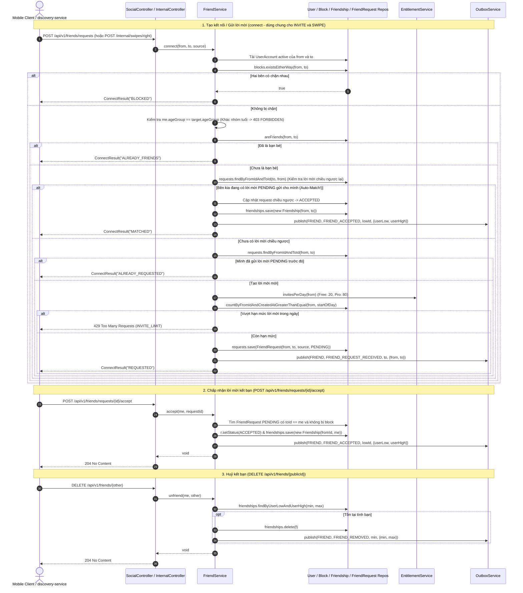
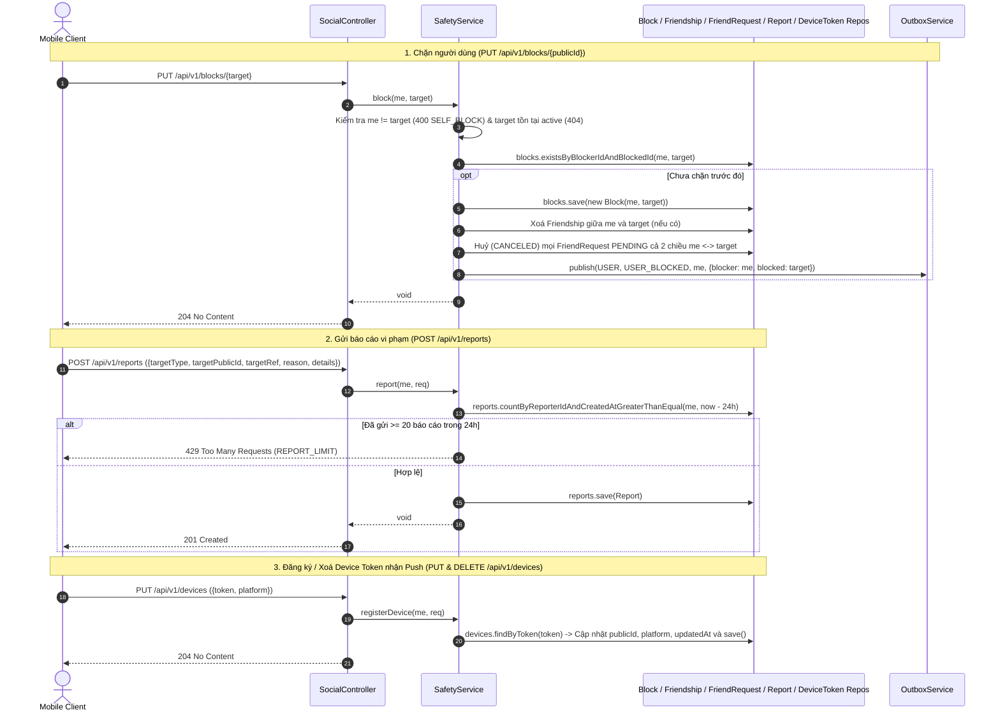
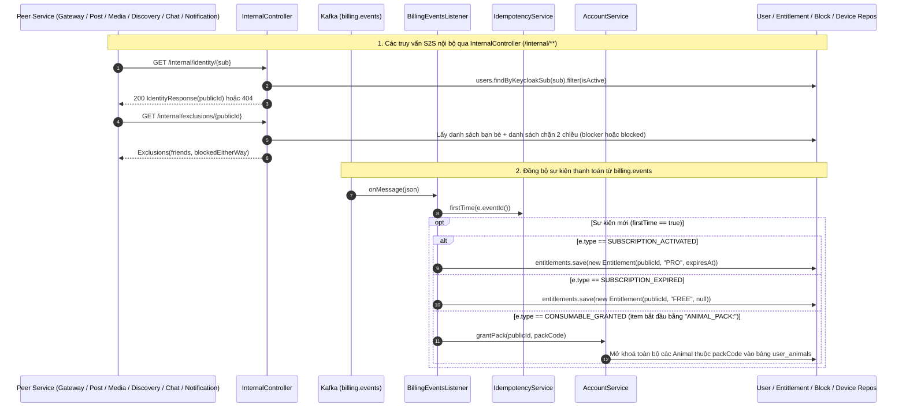

# 02. Kiến trúc `user-service` (`com.animallocket.user`)

`user-service` (`:8101`, MySQL `user_db`) là nguồn sự thật duy nhất (Single Source of Truth) cho:
- Ánh xạ danh tính `keycloakSub` $\leftrightarrow$ `publicId` ẩn danh, nhóm tuổi (`MINOR`/`ADULT`), biệt danh và con vật chủ đạo (`leadAnimal`).
- Bộ sưu tập 25 loài thú (`Animal`, `UserAnimal`) và vòng quay Gacha (`SpinLog`, `AnimalCatalog`).
- Đồ thị xã hội: Bạn bè (`Friendship`), lời mời kết bạn/quẹt phải (`FriendRequest`), chặn hai chiều (`Block`), báo cáo vi phạm (`Report`) và thiết bị nhận thông báo đẩy (`DeviceToken`).
- Bản sao quyền lợi thuê bao Pro (`Entitlement`) nhận từ `billing.events`.

---

## 1. Class Diagram (`user-service`)

```mermaid
classDiagram
    direction TB

    %% ==========================================
    %% Domain Entities (com.animallocket.user.domain)
    %% ==========================================
    class UserAccount {
        <<@Entity users>>
        -Long id
        -String publicId
        -String keycloakSub
        -String alias
        -String leadAnimal
        -LocalDate birthDate
        -AgeGroup ageGroup
        -boolean discoverable
        -Status status
        -Instant aliasChangedAt
        -Instant createdAt
        +isActive() boolean
    }
    note for UserAccount "Thực thể trung tâm lưu hồ sơ người dùng.\nChỉ bảng này chứa keycloakSub và birthDate; không bao giờ trả ra DTO ngoài."

    class Animal {
        <<@Entity animals>>
        -String code
        -String name
        -Rarity rarity
        -String packCode
        +Animal(code, name, rarity, packCode)
    }
    note for Animal "Danh mục con vật (COMMON, RARE, EPIC).\npackCode == null thuộc bộ cơ bản (quay được); khác null thuộc gói trả phí."

    class UserAnimal {
        <<@Entity user_animals>>
        -Long id
        -String publicId
        -String animalCode
        -Instant acquiredAt
    }

    class SpinLog {
        <<@Entity spin_log>>
        -Long id
        -String publicId
        -String animalCode
        -Instant spunAt
    }

    class Friendship {
        <<@Entity friendships>>
        -Long id
        -String userLow
        -String userHigh
        -Instant createdAt
        +Friendship(String a, String b)
        +other(String me) String
    }
    note for Friendship "Quan hệ bạn bè vô hướng.\nLuôn chuẩn hoá userLow < userHigh để đảm bảo duy nhất 1 dòng cho mỗi cặp bạn."

    class FriendRequest {
        <<@Entity friend_requests>>
        -Long id
        -String fromId
        -String toId
        -Source source
        -Status status
        -Instant createdAt
    }
    note for FriendRequest "Lời mời kết bạn từ SWIPE (quẹt phải) hoặc INVITE.\nTrạng thái: PENDING, ACCEPTED, DECLINED, CANCELED."

    class Block {
        <<@Entity blocks>>
        -Long id
        -String blockerId
        -String blockedId
        -Instant createdAt
    }

    class Report {
        <<@Entity reports>>
        -Long id
        -String reporterId
        -String targetPublicId
        -TargetType targetType
        -String targetRef
        -String reason
        -String details
        -Status status
        -Instant createdAt
    }
    note for Report "Báo cáo vi phạm (USER, POST, COMMENT, MESSAGE).\nĐược giữ lại ngay cả khi người dùng xoá tài khoản."

    class DeviceToken {
        <<@Entity device_tokens>>
        -Long id
        -String publicId
        -String token
        -String platform
        -Instant updatedAt
    }

    class Entitlement {
        <<@Entity entitlements>>
        -String publicId
        -String plan
        -Instant expiresAt
        +isActivePro() boolean
    }
    note for Entitlement "Bản sao quyền lợi gói FREE/PRO được cập nhật từ sự kiện billing.events."

    %% ==========================================
    %% Services & Policies (com.animallocket.user.service)
    %% ==========================================
    class AliasPolicy {
        <<final>>
        +validate(String raw)$ String
        +generate(String animalName)$ String
        ~fold(String s)$ String
    }
    note for AliasPolicy "Kiểm tra biệt danh (3-20 ký tự, chặn từ khoá nhạy cảm như admin/support)\nvà sinh biệt danh tiếng Việt ngẫu nhiên."

    class AnimalCatalog {
        <<@Component ApplicationRunner>>
        ~List~Animal~ SEED$
        -AnimalRepository animals
        -Random random
        +run(ApplicationArguments args) void
        +randomStarter() Animal
        +spin(Set~String~ owned) Optional~Animal~
    }
    note for AnimalCatalog "Khởi tạo 25 loài thú khi chạy ứng dụng.\nQuay thưởng theo trọng số: COMMON (70), RARE (25), EPIC (5)."

    class EntitlementService {
        <<@Service>>
        -EntitlementRepository repository
        -int invitesFree
        -int invitesPro
        -Duration spinFree
        -Duration spinPro
        +isPro(String publicId) boolean
        +plan(String publicId) String
        +invitesPerDay(String publicId) int
        +spinInterval(String publicId) Duration
    }

    class IdentityProviderClient {
        <<interface>>
        +deleteUser(String keycloakSub) void
    }

    class KeycloakAdminClient {
        <<@Component>>
        -RestClient http
        -String baseUrl
        -String realm
        -String clientId
        -String clientSecret
        +deleteUser(String sub) void
    }

    class NoopIdentityProviderClient {
        <<@Component>>
        +deleteUser(String sub) void
    }

    class AccountService {
        <<@Service>>
        -UserRepository users
        -AnimalRepository animals
        -UserAnimalRepository userAnimals
        -SpinLogRepository spinLogs
        -FriendshipRepository friendships
        -FriendRequestRepository requests
        -BlockRepository blocks
        -DeviceTokenRepository devices
        -EntitlementRepository entitlementRepo
        -AnimalCatalog catalog
        -EntitlementService entitlements
        -OutboxService outbox
        -IdentityProviderClient identityProvider
        +register(String sub, RegisterRequest req) MeProfile
        +me(String publicId) MeProfile
        +update(String publicId, UpdateProfileRequest req) MeProfile
        +publicProfile(String viewer, String target) PublicProfile
        +setLeadAnimal(String publicId, String animalCode) MeProfile
        +myAnimals(String publicId) List~AnimalView~
        +catalog() List~AnimalView~
        +spin(String publicId) SpinResult
        +grantPack(String publicId, String packCode) void
        +delete(String publicId) void
    }
    note for AccountService "Quản lý trọn vòng đời tài khoản: đăng ký, đổi biệt danh (cooldown 24h),\nđổi thú chủ đạo (cần Pro), quay Gacha và xoá tài khoản (ẩn danh + xoá Keycloak)."

    class FriendService {
        <<@Service>>
        -UserRepository users
        -FriendshipRepository friendships
        -FriendRequestRepository requests
        -BlockRepository blocks
        -EntitlementService entitlements
        -OutboxService outbox
        +connect(String from, String to, Source source) ConnectResult
        +accept(String me, long requestId) void
        +decline(String me, long requestId) void
        +cancel(String me, long requestId) void
        +unfriend(String me, String other) void
        +friends(String me) List~PublicProfile~
        +friendIds(String me) List~String~
        +incoming(String me) List~FriendRequestView~
        +outgoing(String me) List~FriendRequestView~
        +areFriends(String a, String b) boolean
    }
    note for FriendService "Xử lý logic kết bạn hợp nhất cho cả lời mời trực tiếp và quẹt phải.\nBắt buộc cùng nhóm tuổi (MINOR chỉ kết bạn với MINOR, ADULT với ADULT)."

    class SafetyService {
        <<@Service>>
        -UserRepository users
        -BlockRepository blocks
        -FriendshipRepository friendships
        -FriendRequestRepository requests
        -ReportRepository reports
        -DeviceTokenRepository devices
        -OutboxService outbox
        +block(String me, String target) void
        +unblock(String me, String target) void
        +blocked(String me) List~PublicProfile~
        +report(String me, ReportRequest req) void
        +registerDevice(String me, DeviceRequest req) void
        +removeDevice(String me, String token) void
    }

    %% ==========================================
    %% Messaging & Web Controllers
    %% ==========================================
    class BillingEventsListener {
        <<@Component>>
        -IdempotencyService idempotency
        -EntitlementRepository entitlements
        -UserRepository users
        -AccountService accounts
        +onMessage(String json) void
        ~handle(EventEnvelope e) void
    }

    class UserController {
        <<@RestController /api/v1>>
        -AccountService accounts
        +register(Jwt jwt, RegisterRequest req) MeProfile
        +me(String me) MeProfile
        +update(String me, UpdateProfileRequest req) MeProfile
        +delete(String me) void
        +profile(String me, String publicId) PublicProfile
        +leadAnimal(String me, LeadAnimalRequest req) MeProfile
        +myAnimals(String me) List~AnimalView~
        +spin(String me) SpinResult
        +catalog() List~AnimalView~
    }

    class SocialController {
        <<@RestController /api/v1>>
        -FriendService friends
        -SafetyService safety
        +list(String me) List~PublicProfile~
        +unfriend(String me, String publicId) void
        +incoming(String me) List~FriendRequestView~
        +outgoing(String me) List~FriendRequestView~
        +invite(String me, InviteRequest req) ConnectResult
        +accept(String me, long id) void
        +decline(String me, long id) void
        +cancel(String me, long id) void
        +blocked(String me) List~PublicProfile~
        +block(String me, String publicId) void
        +unblock(String me, String publicId) void
        +report(String me, ReportRequest req) void
        +registerDevice(String me, DeviceRequest req) void
        +removeDevice(String me, String token) void
    }

    class InternalController {
        <<@RestController /internal>>
        -UserRepository users
        -BlockRepository blocks
        -DeviceTokenRepository devices
        -FriendService friends
        -EntitlementService entitlements
        +identity(String sub) IdentityResponse
        +user(String publicId) InternalUser
        +batch(List~String~ ids) List~InternalUser~
        +friendIds(String publicId) List~String~
        +relationship(String a, String b) Relationship
        +exclusions(String publicId) Exclusions
        +swipeRight(SwipeRequest req) ConnectResult
        +deviceTokens(String publicId) List~String~
        +removeDeadToken(String token) void
    }

    IdentityProviderClient <|.. KeycloakAdminClient : implements
    IdentityProviderClient <|.. NoopIdentityProviderClient : implements
    UserController --> AccountService : delegates
    SocialController --> FriendService : delegates
    SocialController --> SafetyService : delegates
    InternalController --> FriendService : queries/connects
    InternalController --> EntitlementService : checks Pro
    AccountService --> AnimalCatalog : uses
    AccountService --> AliasPolicy : validates
    AccountService --> EntitlementService : checks limits/plan
    AccountService --> IdentityProviderClient : deletes IdP user
    FriendService --> EntitlementService : checks invite limit
    BillingEventsListener --> AccountService : grants animal pack
```



---

## 2. Sequence Diagrams theo Từng Class (`user-service`)

### 2.1 Class `UserController` & `AccountService` — Đăng ký, Quản lý Hồ sơ, Quay Thú & Xoá Tài khoản

```mermaid
sequenceDiagram
    autonumber
    actor Client as Mobile Client (qua Gateway)
    participant UC as UserController
    participant AS as AccountService
    participant AP as AliasPolicy
    participant AC as AnimalCatalog
    participant Ent as EntitlementService
    participant Repo as JPA Repositories (MySQL)
    participant Outbox as OutboxService
    participant IdP as IdentityProviderClient (Keycloak)

    Note over Client,Outbox: 1. Đăng ký hồ sơ ẩn danh (POST /api/v1/users/register)
    Client->>UC: POST /api/v1/users/register (JWT principal, {alias, birthDate})
    UC->>AS: register(jwt.getSubject(), req)
    AS->>Repo: users.findByKeycloakSub(sub)
    alt Đã tồn tại tài khoản với sub này (Idempotent)
        Repo-->>AS: existing UserAccount
        AS-->>UC: toMe(existing)
    else Đăng ký mới
        AS->>AS: Kiểm tra birthDate (tuổi <= 120, không ở tương lai; < 18 -> MINOR, >= 18 -> ADULT)
        AS->>AC: randomStarter() (Chọn ngẫu nhiên 1 thú COMMON bộ cơ bản)
        AC-->>AS: starter Animal
        AS->>AP: validate(req.alias) hoặc generate(starter.name)
        AP-->>AS: alias hợp lệ
        AS->>Repo: users.save(UserAccount) & userAnimals.save(UserAnimal)
        AS->>Outbox: publish(USER, USER_REGISTERED, publicId, {publicId, ageGroup, leadAnimal})
        AS->>Ent: plan(publicId)
        Ent-->>AS: "FREE"
        AS-->>UC: MeProfile
    end
    UC-->>Client: 201 Created (MeProfile)

    Note over Client,Outbox: 2. Cập nhật biệt danh / Bật tắt khám phá (PATCH /api/v1/users/me)
    Client->>UC: PATCH /api/v1/users/me ({alias, discoverable})
    UC->>AS: update(me, req)
    AS->>Repo: requireActive(me)
    opt Đổi alias mới
        AS->>AS: Kiểm tra aliasChangedAt + 24h > now -> nếu vi phạm ném 429 ALIAS_COOLDOWN
        AS->>AP: validate(req.alias)
        AS->>AS: Cập nhật u.alias & u.aliasChangedAt = now
    end
    opt Tắt discoverable (từ true -> false)
        AS->>Outbox: publish(USER, DISCOVERY_DISABLED, me, {publicId: me})
    end
    AS-->>UC: MeProfile
    UC-->>Client: 200 OK (MeProfile)

    Note over Client,Outbox: 3. Đổi con vật chủ đạo (PUT /api/v1/users/me/lead-animal)
    Client->>UC: PUT /api/v1/users/me/lead-animal ({animalCode})
    UC->>AS: setLeadAnimal(me, animalCode)
    AS->>Ent: isPro(me)
    alt Không phải gói PRO
        Ent-->>AS: false
        AS-->>Client: 402 Payment Required (PRO_REQUIRED)
    else Đang là PRO
        AS->>Repo: userAnimals.existsByPublicIdAndAnimalCode(me, animalCode)
        alt Chưa sở hữu con vật
            AS-->>Client: 400 Bad Request (ANIMAL_NOT_OWNED)
        else Đã sở hữu
            AS->>AS: u.setLeadAnimal(animalCode)
            AS->>Outbox: publish(USER, LEAD_ANIMAL_CHANGED, me, {publicId, animalCode})
            AS-->>UC: MeProfile
            UC-->>Client: 200 OK
        end
    end

    Note over Client,Outbox: 4. Quay thưởng con vật Gacha (POST /api/v1/users/me/spin)
    Client->>UC: POST /api/v1/users/me/spin
    UC->>AS: spin(me)
    AS->>Ent: spinInterval(me) (Free: 7 ngày, Pro: 1 ngày)
    AS->>Repo: spinLogs.findFirstByPublicIdOrderBySpunAtDesc(me)
    alt Chưa hết thời gian chờ (Cooldown)
        AS-->>Client: 429 Too Many Requests (SPIN_COOLDOWN)
    else Đủ điều kiện quay
        AS->>Repo: userAnimals.findByPublicId(me) -> Tập mã thú đã sở hữu
        AS->>AC: spin(ownedSet) (Trọng số COMMON 70 / RARE 25 / EPIC 5)
        alt Đã sưu tập đủ toàn bộ thú cơ bản
            AC-->>AS: Optional.empty()
            AS-->>Client: 409 Conflict (COLLECTION_COMPLETE)
        else Quay trúng thú mới
            AC-->>AS: won Animal
            AS->>Repo: userAnimals.save(UserAnimal) & spinLogs.save(SpinLog)
            AS-->>UC: SpinResult(AnimalView, nextSpinAt)
            UC-->>Client: 200 OK (SpinResult)
        end
    end

    Note over Client,IdP: 5. Xoá tài khoản vĩnh viễn (DELETE /api/v1/users/me)
    Client->>UC: DELETE /api/v1/users/me
    UC->>AS: delete(me)
    AS->>Repo: Xoá friendships, requests, blocks, devices, userAnimals, spinLogs, entitlements
    AS->>Repo: Ẩn danh UserAccount (status=DELETED, alias="deleted", keycloakSub="deleted:"+me, birthDate=null)
    AS->>Outbox: publish(USER, USER_DELETED, me, {publicId: me})
    AS->>IdP: deleteUser(originalKeycloakSub)
    alt Keycloak xoá thành công
        IdP-->>AS: OK (Commit toàn bộ Transaction)
        UC-->>Client: 204 No Content
    else Keycloak lỗi (Fail-closed)
        IdP-->>AS: Exception (Rollback toàn bộ DB + Outbox để người dùng thử lại)
        UC-->>Client: 500 / 503 Error
    end
```

---

### 2.2 Class `SocialController` & `FriendService` — Kết bạn, Chấp nhận / Từ chối / Huỷ kết bạn



---

### 2.3 Class `SocialController` & `SafetyService` — Chặn, Báo cáo & Thiết bị Push



---

### 2.4 Class `InternalController` & `BillingEventsListener` — Tra cứu Nội bộ & Đồng bộ Quyền lợi



