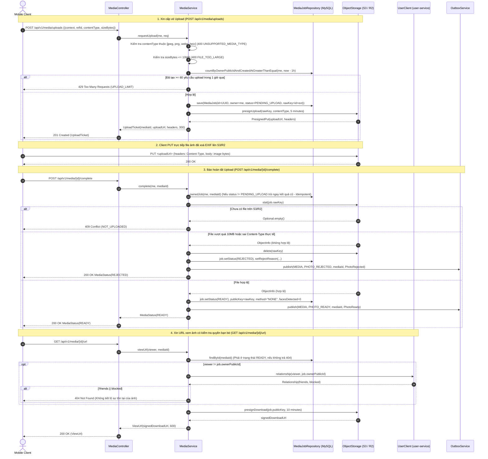
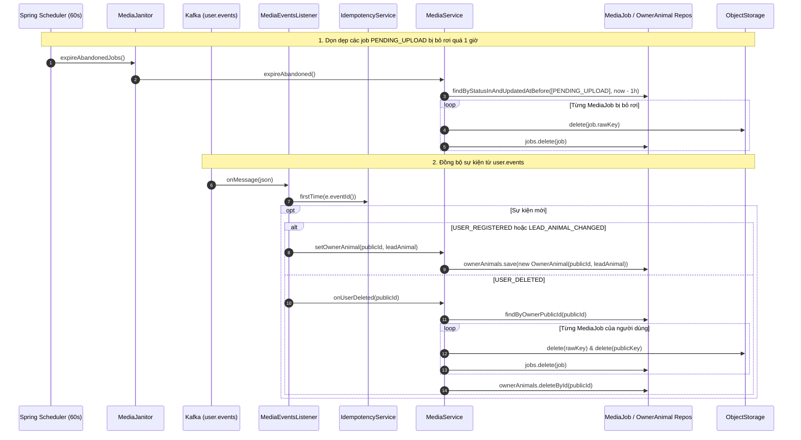

# 03. Kiến trúc `media-service` (`com.animallocket.media`)

`media-service` (`:8103`, MySQL `media_db` + S3/Cloudflare R2) chịu trách nhiệm:
- Cấp vé upload trực tiếp lên kho lưu trữ đối tượng (`Presigned PUT` URL sống 5 phút) kèm kiểm tra hạn mức 60 ảnh/giờ.
- Xác nhận hoàn tất upload (`complete`), kiểm tra đối tượng thực tế trên bucket (`stat`), kiểm tra kích thước & `Content-Type`, chuyển trạng thái `READY` và phát sự kiện `PHOTO_READY` (hoặc `PHOTO_REJECTED`) qua Outbox.
- Cấp URL xem ảnh ngắn hạn (10 phút) sau khi xác minh người xem là chủ ảnh hoặc là bạn bè không bị chặn thông qua `UserClient`.
- Dọn dẹp định kỳ các job `PENDING_UPLOAD` bị bỏ rơi sau 1 giờ (`MediaJanitor`).

---

## 1. Class Diagram (`media-service`)

```mermaid
classDiagram
    direction TB

    %% ==========================================
    %% Domain Entities & Repositories
    %% ==========================================
    class MediaJob {
        <<@Entity media_jobs>>
        -String id
        -String ownerPublicId
        -Context context
        -String refId
        -String rawKey
        -String publicKey
        -Status status
        -String leadAnimal
        -String method
        -Integer facesDetected
        -String rejectReason
        -Instant createdAt
        -Instant updatedAt
        +touch() void
    }
    note for MediaJob "Theo dõi vòng đời ảnh:\n- Context: POST | CHAT\n- Status: PENDING_UPLOAD -> READY | REJECTED."

    class OwnerAnimal {
        <<@Entity owner_animals>>
        -String publicId
        -String leadAnimal
    }
    note for OwnerAnimal "Bản sao cục bộ con vật chủ đạo của người dùng\nđược đồng bộ từ sự kiện USER_REGISTERED và LEAD_ANIMAL_CHANGED."

    class MediaJobRepository {
        <<interface>>
        +findByStatusInAndUpdatedAtBefore(Collection~Status~ statuses, Instant before) List~MediaJob~
        +findByOwnerPublicId(String ownerPublicId) List~MediaJob~
        +countByOwnerPublicIdAndCreatedAtGreaterThanEqual(String ownerPublicId, Instant since) long
    }

    class OwnerAnimalRepository {
        <<interface>>
    }

    %% ==========================================
    %% Storage & S2S Client
    %% ==========================================
    class ObjectStorage {
        <<interface>>
        +presignUpload(String key, String contentType, Duration ttl) PresignedPut
        +presignDownload(String key, Duration ttl) String
        +stat(String key) Optional~ObjectInfo~
        +delete(String key) void
    }
    note for ObjectStorage "Giao diện trừu tượng hoá kho lưu trữ đối tượng S3 / Cloudflare R2."

    class S3ObjectStorage {
        <<@Component>>
        -MinioClient client
        -MinioClient signer
        -String bucket
        +presignUpload(String key, String contentType, Duration ttl) PresignedPut
        +presignDownload(String key, Duration ttl) String
        +stat(String key) Optional~ObjectInfo~
        +delete(String key) void
    }
    note for S3ObjectStorage "Sử dụng MinioClient tương thích S3/R2.\nCấp Presigned PUT kèm header Content-Type bắt buộc."

    class UserClient {
        <<@Component>>
        -RestClient client
        -CircuitBreakerFactory breakers
        +user(String publicId) Optional~InternalUser~
        +relationship(String a, String b) Relationship
    }
    note for UserClient "Gọi nội bộ sang user-service có bọc CircuitBreaker.\nFail-closed (503 USER_SERVICE_UNAVAILABLE) nếu không kiểm tra được quan hệ bạn bè."

    %% ==========================================
    %% Services, Janitor, Listener & Controller
    %% ==========================================
    class MediaService {
        <<@Service>>
        -MediaJobRepository jobs
        -OwnerAnimalRepository ownerAnimals
        -ObjectStorage storage
        -UserClient users
        -OutboxService outbox
        -long maxBytes
        -int maxUploadsPerHour
        +requestUpload(String owner, UploadRequest req) UploadTicket
        +complete(String owner, String mediaId) MediaStatus
        +status(String owner, String mediaId) MediaStatus
        +viewUrl(String viewer, String mediaId) ViewUrl
        +internal(String mediaId) InternalMedia
        +setOwnerAnimal(String publicId, String animal) void
        +onUserDeleted(String publicId) void
        +expireAbandoned() int
    }

    class MediaJanitor {
        <<@Component>>
        -MediaService media
        +expireAbandonedJobs() void
    }
    note for MediaJanitor "Quét mỗi 60 giây để xoá các job PENDING_UPLOAD quá 1 giờ và dọn file rác trên S3/R2."

    class MediaEventsListener {
        <<@Component>>
        -IdempotencyService idempotency
        -MediaService media
        +onMessage(String json) void
        ~handle(EventEnvelope e) void
    }

    class MediaController {
        <<@RestController>>
        -MediaService media
        +upload(String me, UploadRequest req) UploadTicket
        +complete(String me, String id) MediaStatus
        +status(String me, String id) MediaStatus
        +url(String me, String id) ViewUrl
        +internal(String id) InternalMedia
    }

    ObjectStorage <|.. S3ObjectStorage : implements
    MediaController --> MediaService : delegates
    MediaJanitor --> MediaService : schedules
    MediaEventsListener --> MediaService : updates/deletes
    MediaService --> MediaJobRepository : persists
    MediaService --> OwnerAnimalRepository : caches animal
    MediaService --> ObjectStorage : presigns & stats
    MediaService --> UserClient : verifies friendship
```

---

## 2. Sequence Diagrams theo Từng Class (`media-service`)

### 2.1 Class `MediaController` & `MediaService` — Xin vé Upload, Hoàn tất Upload & Cấp URL Xem ảnh

---

### 2.2 Class `MediaJanitor` & `MediaEventsListener` — Dọn dẹp định kỳ & Đồng bộ Sự kiện

