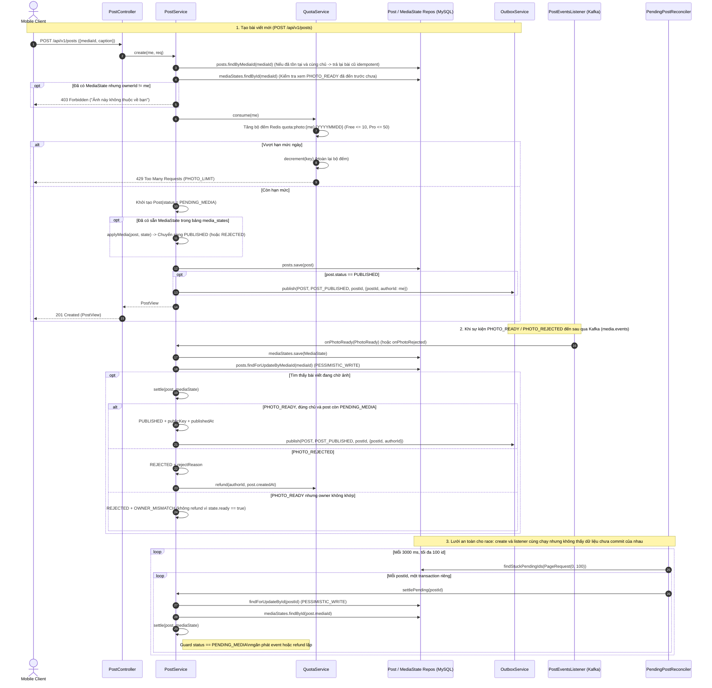
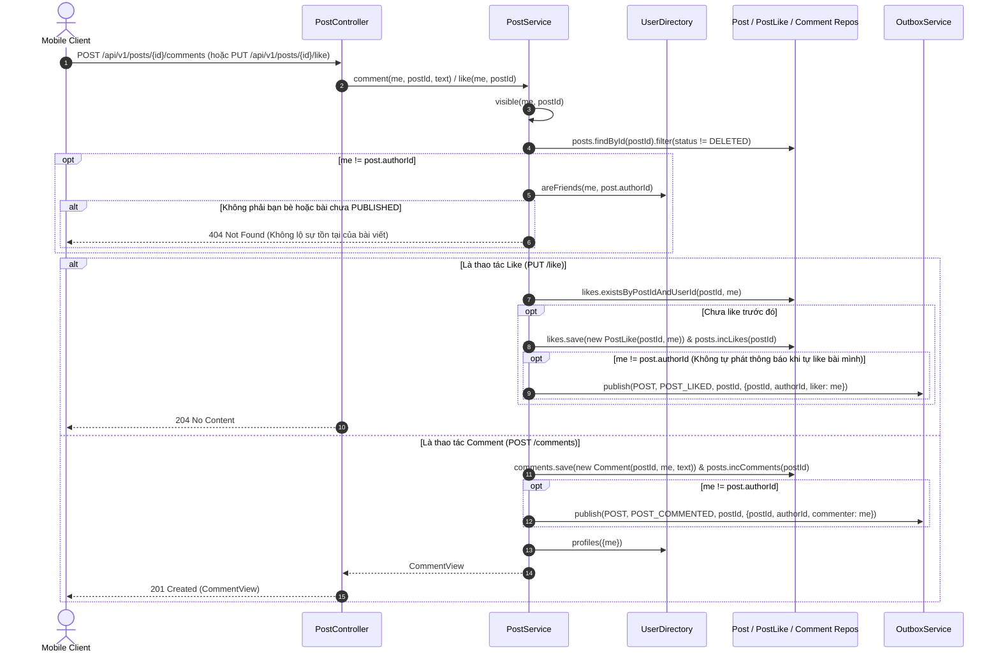

# 04. Kiến trúc `post-service` (`com.animallocket.post`)

`post-service` (`:8102`, MySQL `post_db` + Redis) quản lý:
- Bài đăng ảnh (`Post`), lượt thích (`PostLike`), bình luận (`Comment`) và bảng tin bạn bè (`FeedPage`).
- Danh sách bài theo người dùng qua `GET /api/v1/posts/by/{publicId}`: chủ tài khoản thấy mọi bài chưa xoá; bạn bè chỉ thấy bài `PUBLISHED`; người lạ nhận `404` để không lộ dữ liệu.
- Đồng bộ bất đồng bộ trạng thái ảnh (`MediaState`) từ `media-service`, gồm cả hai thứ tự `PHOTO_READY` đến trước hoặc sau khi client gọi `POST /api/v1/posts`.
- Tự sửa bài kẹt `PENDING_MEDIA` bằng `PendingPostReconciler` khi transaction tạo bài chạy đồng thời với listener media; quá trình settle dùng khoá dòng để không phát sự kiện hoặc hoàn quota hai lần.
- Quản lý hạn mức đăng ảnh theo ngày giờ Việt Nam (`QuotaService`: Free 10 ảnh/ngày, Pro 50 ảnh/ngày; tự động hoàn lượt khi ảnh bị từ chối).
- Tra cứu danh sách bạn bè với cache 2 tầng trên Redis (tươi 45 giây + bản dự phòng 1 giờ khi `user-service` gặp sự cố) và cache hồ sơ hiển thị trên Caffeine (`UserDirectory`), gồm `alias`, `leadAnimal` và chuỗi `avatar` để client tự vẽ.

`PostView` và `CommentView` không trả `publicKey` hay URL kho ảnh. Client lấy ảnh đã ẩn mặt qua `media-service` bằng `mediaId`.

---

## 1. Class Diagram (`post-service`)

```mermaid
classDiagram
    direction TB

    %% ==========================================
    %% Domain Entities & Repositories
    %% ==========================================
    class Post {
        <<@Entity posts>>
        -String id
        -String authorId
        -String caption
        -String mediaId
        -String publicKey
        -Status status
        -String rejectReason
        -int likeCount
        -int commentCount
        -Instant createdAt
        -Instant publishedAt
    }
    note for Post "Trạng thái bài viết (Status):\nPENDING_MEDIA -> PUBLISHED (khi PHOTO_READY)\n              -> REJECTED (khi PHOTO_REJECTED)\nMọi trạng thái -> DELETED."

    class PostLike {
        <<@Entity post_likes>>
        -Long id
        -String postId
        -String userId
        -Instant createdAt
    }

    class Comment {
        <<@Entity comments>>
        -Long id
        -String postId
        -String authorId
        -String text
        -Instant createdAt
    }

    class MediaState {
        <<@Entity media_states>>
        -String mediaId
        -String ownerId
        -String status
        -String publicKey
        -String reason
        -Instant updatedAt
        +ready() boolean
    }
    note for MediaState "Lưu kết quả xử lý ảnh từ media.events.\nGiải quyết race condition khi PHOTO_READY đến trước lúc client gọi tạo bài."

    class PostRepository {
        <<interface>>
        +findByMediaId(String mediaId) Optional~Post~
        +findForUpdateByMediaId(String mediaId) Optional~Post~
        +findForUpdateById(String id) Optional~Post~
        +findStuckPendingIds(Pageable page) List~String~
        +findByAuthorIdInAndStatusAndPublishedAtLessThanOrderByPublishedAtDesc(...) List~Post~
        +findByAuthorIdAndStatusNotOrderByCreatedAtDesc(...) List~Post~
        +findByAuthorIdAndStatusNotAndCreatedAtLessThanOrderByCreatedAtDesc(...) List~Post~
        +incLikes(String id) void
        +decLikes(String id) void
        +incComments(String id) void
        +decComments(String id) void
    }
    note for PostRepository "findForUpdateBy* dùng PESSIMISTIC_WRITE (SELECT ... FOR UPDATE).\nfindStuckPendingIds tìm PENDING_MEDIA đã có MediaState để reconciler xử lý."

    class PostLikeRepository {
        <<interface>>
        +existsByPostIdAndUserId(String postId, String userId) boolean
        +deleteByPostIdAndUserId(String postId, String userId) long
        +likedAmong(String userId, Collection~String~ postIds) List~String~
        +deleteAllOfPost(String postId) void
        +deleteAllOfUser(String userId) void
    }

    class CommentRepository {
        <<interface>>
        +findByPostIdAndIdGreaterThanOrderByIdAsc(String postId, long afterId, Pageable page) List~Comment~
        +deleteAllOfPost(String postId) void
        +findByAuthorId(String authorId) List~Comment~
    }

    class MediaStateRepository {
        <<interface>>
        +deleteByOwnerId(String ownerId) void
    }

    %% ==========================================
    %% Client, Services, Listener & Controller
    %% ==========================================
    class UserDirectory {
        <<@Component>>
        -RestClient client
        -CircuitBreakerFactory breakers
        -KeyValueStore kv
        -Cache~String, Profile~ profileCache
        +friendIds(String me) Set~String~
        +areFriends(String a, String b) boolean
        +invalidateFriends(String... ids) void
        +profiles(Set~String~ ids) Map~String, Profile~
    }
    note for UserDirectory "Cổng giao tiếp sang user-service:\n- Danh sách bạn: cache Redis tươi 45s + bản cũ (stale) 1h.\n- Profile(publicId, alias, leadAnimal, avatar): cache Caffeine 5 phút, fail-soft."

    class QuotaService {
        <<@Service>>
        -KeyValueStore kv
        -int freeLimit
        -int proLimit
        +isPro(String publicId) boolean
        +setPro(String publicId, Instant expiresAt) void
        +clearPro(String publicId) void
        +consume(String publicId) void
        +refund(String publicId, Instant createdAt) void
    }
    note for QuotaService "Đếm hạn mức ảnh/ngày theo múi giờ Asia/Ho_Chi_Minh.\nKhoá Redis: quota:photo:{id}:{YYYYMMDD} (TTL 30h)."

    class PostService {
        <<@Service>>
        -PostRepository posts
        -PostLikeRepository likes
        -CommentRepository comments
        -MediaStateRepository mediaStates
        -UserDirectory users
        -QuotaService quota
        -OutboxService outbox
        +create(String me, CreatePostRequest req) PostView
        +delete(String me, String postId) void
        +get(String me, String postId) PostView
        +feed(String me, Instant before, int limit) FeedPage
        +userPosts(String me, String author, Instant before, int limit) FeedPage
        +mine(String me, int limit) List~PostView~
        +like(String me, String postId) void
        +unlike(String me, String postId) void
        +comment(String me, String postId, String text) CommentView
        +comments(String me, String postId, long afterId, int limit) CommentPage
        +deleteComment(String me, String postId, long commentId) void
        +onPhotoReady(PhotoReady e) void
        +onPhotoRejected(PhotoRejected e) void
        +settlePending(String postId) void
        +onUserDeleted(String publicId) void
        -settle(Post p, MediaState state) void
        -applyMedia(Post p, MediaState s) void
        -visible(String me, String postId) Post
    }

    class PendingPostReconciler {
        <<@Component>>
        -int BATCH = 100
        -PostRepository posts
        -PostService service
        +reconcile() void
    }
    note for PendingPostReconciler "@Scheduled fixed delay mặc định 3000 ms.\nTìm tối đa 100 bài PENDING_MEDIA đã có MediaState;\nmỗi bài được settle trong transaction riêng."

    class PostEventsListener {
        <<@Component>>
        -IdempotencyService idempotency
        -PostService posts
        -QuotaService quota
        -UserDirectory users
        +onMessage(String json) void
        ~handle(EventEnvelope e) void
    }

    class PostController {
        <<@RestController /api/v1>>
        -PostService posts
        +create(String me, CreatePostRequest req) PostView
        +mine(String me, int limit) List~PostView~
        +get(String me, String id) PostView
        +delete(String me, String id) void
        +userPosts(String me, String publicId, Instant before, int limit) FeedPage
        +feed(String me, Instant before, int limit) FeedPage
        +like(String me, String id) void
        +unlike(String me, String id) void
        +comment(String me, String id, CommentRequest req) CommentView
        +comments(String me, String id, long after, int limit) CommentPage
        +deleteComment(String me, String id, long commentId) void
    }

    PostController --> PostService : delegates
    PostEventsListener --> PostService : media & user events
    PostEventsListener --> QuotaService : updates Pro
    PostEventsListener --> UserDirectory : invalidates friend cache
    PostService --> PostRepository : queries & saves
    PostService --> PostLikeRepository : manages likes
    PostService --> CommentRepository : manages comments
    PostService --> MediaStateRepository : checks media state
    PostService --> UserDirectory : checks friends & profiles
    PostService --> QuotaService : consumes & refunds quota
    PendingPostReconciler --> PostRepository : finds stuck ids
    PendingPostReconciler --> PostService : settlePending per id
```



---

## 2. Sequence Diagrams theo Từng Class (`post-service`)

### 2.1 Class `PostController`, `PostService`, `QuotaService` & `PendingPostReconciler` — Tạo bài và chốt trạng thái media



---

### 2.2 Class `PostService` & `UserDirectory` — Tải Bảng tin Bạn bè (Feed) & Chịu lỗi 2 Tầng Cache

```mermaid
sequenceDiagram
    autonumber
    actor Client as Mobile Client
    participant PC as PostController
    participant PS as PostService
    participant UD as UserDirectory
    participant KV as KeyValueStore (Redis)
    participant UserSvc as user-service (/internal/*)
    participant Repo as Post / PostLike Repos (MySQL)

    Client->>PC: GET /api/v1/feed?before=...&limit=20
    PC->>PS: feed(me, before, limit)
    PS->>UD: friendIds(me)
    UD->>KV: get("friends:" + me) (Cache tươi 45 giây)
    alt Cache Tươi Hit
        KV-->>UD: CSV danh sách bạn
    else Cache Tươi Miss
        UD->>UserSvc: GET /internal/friends/{me} (qua CircuitBreaker "user-service")
        alt user-service phản hồi 200 OK
            UserSvc-->>UD: List<String> friendIds
            UD->>KV: set("friends:" + me, csv, 45s) & set("friends:stale:" + me, csv, 1h)
        else user-service lỗi / Mạch mở
            UD->>KV: get("friends:stale:" + me) (Cache dự phòng 1 giờ)
            alt Có bản cache dự phòng (Stale Hit)
                KV-->>UD: CSV danh sách bạn cũ
            else Không có cả bản dự phòng (Stale Miss)
                UD-->>PS: throw ApiException(503 FRIENDS_UNAVAILABLE)
                PS-->>PC: FeedPage(items=[], nextBefore=null, degraded=true) (Fail-soft!)
                PC-->>Client: 200 OK (degraded = true)
            end
        end
    end
    UD-->>PS: Set<String> friendIds
    PS->>PS: authors = friendIds + {me}
    PS->>Repo: findByAuthorIdInAndStatusAndPublishedAtLessThanOrderByPublishedAtDesc(authors, PUBLISHED, before, limit)
    Repo-->>PS: List<Post> page
    PS->>UD: profiles(authorIds) (Đọc Caffeine cache 5m, thiếu mới gọi GET /internal/users?ids=...)
    UD-->>PS: Map<String, Profile> (publicId, alias, leadAnimal, avatar; fail-soft)
    PS->>Repo: likes.likedAmong(me, postIds)
    PS-->>PC: FeedPage(items, nextBefore, degraded=false)
    PC-->>Client: 200 OK (FeedPage)
```

---

### 2.3 Class `PostController` & `PostService` — Xem bài theo người dùng

```mermaid
sequenceDiagram
    autonumber
    actor Client as Mobile Client
    participant PC as PostController
    participant PS as PostService
    participant UD as UserDirectory
    participant Repo as Post / PostLike Repos (MySQL)

    Client->>PC: GET /api/v1/posts/by/{publicId}?before=...&limit=30
    PC->>PS: userPosts(me, publicId, before, limit)
    PS->>PS: size = clamp(limit, 1, 50)\ncursor = before ?? now + 60s
    alt publicId == me
        PS->>Repo: findByAuthorIdAndStatusNotAndCreatedAtLessThanOrderByCreatedAtDesc(me, DELETED, cursor, size)
        Note right of Repo: Trả PENDING_MEDIA, PUBLISHED và REJECTED;\nsắp xếp và phân trang theo createdAt
    else Xem hồ sơ người khác
        PS->>UD: areFriends(me, publicId)
        alt Không phải bạn hoặc không xác minh được quan hệ
            PS-->>Client: 404 Not Found (không lộ người dùng có bài)
        else Là bạn
            PS->>Repo: findByAuthorIdInAndStatusAndPublishedAtLessThanOrderByPublishedAtDesc({publicId}, PUBLISHED, cursor, size)
            Note right of Repo: Chỉ trả PUBLISHED;\nsắp xếp và phân trang theo publishedAt
        end
    end
    PS->>UD: profiles(authorIds)
    PS->>Repo: likes.likedAmong(me, postIds)
    PS-->>PC: FeedPage(items, nextBefore, degraded=false)
    PC-->>Client: 200 OK
```

---

### 2.4 Class `PostService` — Thích, bình luận và kiểm tra quyền xem (`visible`)



