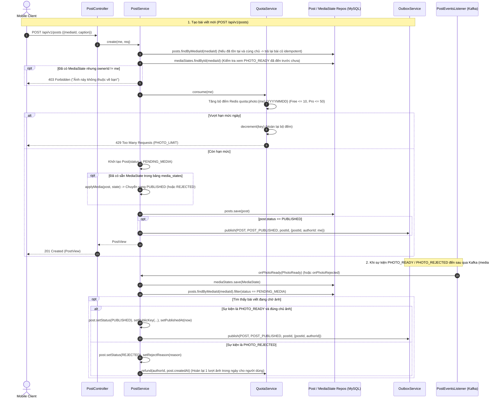
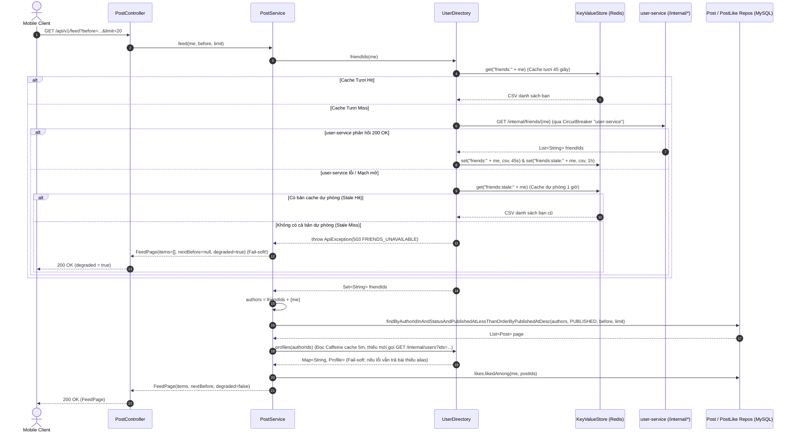
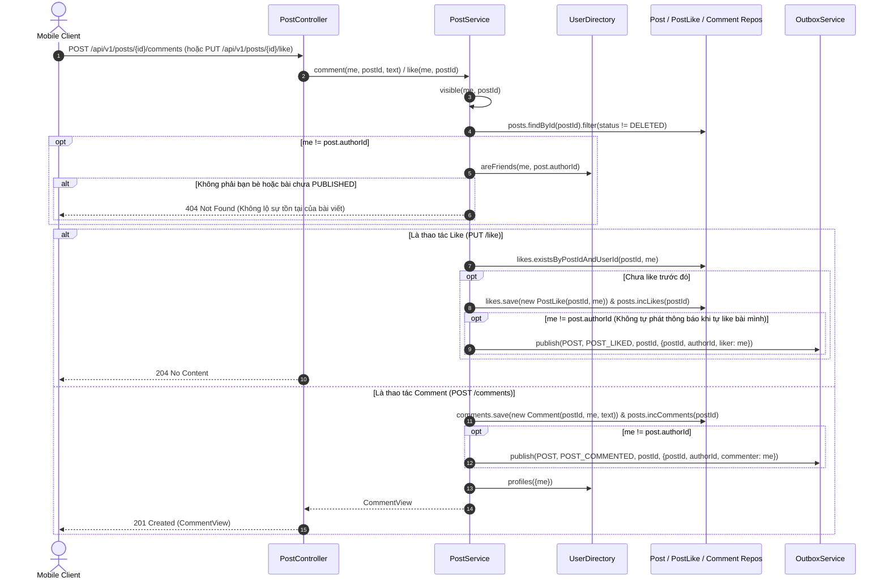

# 04. Kiến trúc `post-service` (`com.animallocket.post`)

`post-service` (`:8102`, MySQL `post_db` + Redis) quản lý:
- Bài đăng ảnh (`Post`), lượt thích (`PostLike`), bình luận (`Comment`) và bảng tin bạn bè (`FeedPage`).
- Đồng bộ bất đồng bộ trạng thái ảnh (`MediaState`) từ `media-service` (xử lý được cả trường hợp sự kiện `PHOTO_READY` đến trước khi client gọi `POST /api/v1/posts`).
- Quản lý hạn mức đăng ảnh theo ngày giờ Việt Nam (`QuotaService`: Free 10 ảnh/ngày, Pro 50 ảnh/ngày; tự động hoàn lượt khi ảnh bị từ chối).
- Tra cứu danh sách bạn bè với cache 2 tầng trên Redis (tươi 45 giây + bản dự phòng 1 giờ khi `user-service` gặp sự cố) và cache hồ sơ hiển thị trên Caffeine (`UserDirectory`).

---

## 1. Class Diagram (`post-service`)

```mermaid
classDiagram
    direction TB

    %% ==========================================
    %% Domain Entities & Repositories
    %% ==========================================
    class Post {
        <<@Entity posts>>
        -String id
        -String authorId
        -String caption
        -String mediaId
        -String publicKey
        -Status status
        -String rejectReason
        -int likeCount
        -int commentCount
        -Instant createdAt
        -Instant publishedAt
    }
    note for Post "Trạng thái bài viết (Status):\nPENDING_MEDIA -> PUBLISHED (khi PHOTO_READY)\n              -> REJECTED (khi PHOTO_REJECTED)\nMọi trạng thái -> DELETED."

    class PostLike {
        <<@Entity post_likes>>
        -Long id
        -String postId
        -String userId
        -Instant createdAt
    }

    class Comment {
        <<@Entity comments>>
        -Long id
        -String postId
        -String authorId
        -String text
        -Instant createdAt
    }

    class MediaState {
        <<@Entity media_states>>
        -String mediaId
        -String ownerId
        -String status
        -String publicKey
        -String reason
        -Instant updatedAt
        +ready() boolean
    }
    note for MediaState "Lưu kết quả xử lý ảnh từ media.events.\nGiải quyết race condition khi PHOTO_READY đến trước lúc client gọi tạo bài."

    class PostRepository {
        <<interface>>
        +findByMediaId(String mediaId) Optional~Post~
        +findByAuthorIdInAndStatusAndPublishedAtLessThanOrderByPublishedAtDesc(...) List~Post~
        +findByAuthorIdAndStatusNotOrderByCreatedAtDesc(...) List~Post~
        +incLikes(String id) void
        +decLikes(String id) void
        +incComments(String id) void
        +decComments(String id) void
    }

    class PostLikeRepository {
        <<interface>>
        +existsByPostIdAndUserId(String postId, String userId) boolean
        +deleteByPostIdAndUserId(String postId, String userId) long
        +likedAmong(String userId, Collection~String~ postIds) List~String~
        +deleteAllOfPost(String postId) void
        +deleteAllOfUser(String userId) void
    }

    class CommentRepository {
        <<interface>>
        +findByPostIdAndIdGreaterThanOrderByIdAsc(String postId, long afterId, Pageable page) List~Comment~
        +deleteAllOfPost(String postId) void
        +findByAuthorId(String authorId) List~Comment~
    }

    class MediaStateRepository {
        <<interface>>
        +deleteByOwnerId(String ownerId) void
    }

    %% ==========================================
    %% Client, Services, Listener & Controller
    %% ==========================================
    class UserDirectory {
        <<@Component>>
        -RestClient client
        -CircuitBreakerFactory breakers
        -KeyValueStore kv
        -Cache~String, Profile~ profileCache
        +friendIds(String me) Set~String~
        +areFriends(String a, String b) boolean
        +invalidateFriends(String... ids) void
        +profiles(Set~String~ ids) Map~String, Profile~
    }
    note for UserDirectory "Cổng giao tiếp sang user-service:\n- Danh sách bạn: cache Redis tươi 45s + bản cũ (stale) 1h.\n- Hồ sơ hiển thị: cache Caffeine 5 phút (fail-soft)."

    class QuotaService {
        <<@Service>>
        -KeyValueStore kv
        -int freeLimit
        -int proLimit
        +isPro(String publicId) boolean
        +setPro(String publicId, Instant expiresAt) void
        +clearPro(String publicId) void
        +consume(String publicId) void
        +refund(String publicId, Instant createdAt) void
    }
    note for QuotaService "Đếm hạn mức ảnh/ngày theo múi giờ Asia/Ho_Chi_Minh.\nKhoá Redis: quota:photo:{id}:{YYYYMMDD} (TTL 30h)."

    class PostService {
        <<@Service>>
        -PostRepository posts
        -PostLikeRepository likes
        -CommentRepository comments
        -MediaStateRepository mediaStates
        -UserDirectory users
        -QuotaService quota
        -OutboxService outbox
        +create(String me, CreatePostRequest req) PostView
        +delete(String me, String postId) void
        +get(String me, String postId) PostView
        +feed(String me, Instant before, int limit) FeedPage
        +mine(String me, int limit) List~PostView~
        +like(String me, String postId) void
        +unlike(String me, String postId) void
        +comment(String me, String postId, String text) CommentView
        +comments(String me, String postId, long afterId, int limit) CommentPage
        +deleteComment(String me, String postId, long commentId) void
        +onPhotoReady(PhotoReady e) void
        +onPhotoRejected(PhotoRejected e) void
        +onUserDeleted(String publicId) void
        -applyMedia(Post p, MediaState s) void
        -visible(String me, String postId) Post
    }

    class PostEventsListener {
        <<@Component>>
        -IdempotencyService idempotency
        -PostService posts
        -QuotaService quota
        -UserDirectory users
        +onMessage(String json) void
        ~handle(EventEnvelope e) void
    }

    class PostController {
        <<@RestController /api/v1>>
        -PostService posts
        +create(String me, CreatePostRequest req) PostView
        +mine(String me, int limit) List~PostView~
        +get(String me, String id) PostView
        +delete(String me, String id) void
        +feed(String me, Instant before, int limit) FeedPage
        +like(String me, String id) void
        +unlike(String me, String id) void
        +comment(String me, String id, CommentRequest req) CommentView
        +comments(String me, String id, long after, int limit) CommentPage
        +deleteComment(String me, String id, long commentId) void
    }

    PostController --> PostService : delegates
    PostEventsListener --> PostService : media & user events
    PostEventsListener --> QuotaService : updates Pro
    PostEventsListener --> UserDirectory : invalidates friend cache
    PostService --> PostRepository : queries & saves
    PostService --> PostLikeRepository : manages likes
    PostService --> CommentRepository : manages comments
    PostService --> MediaStateRepository : checks media state
    PostService --> UserDirectory : checks friends & profiles
    PostService --> QuotaService : consumes & refunds quota
```

---

## 2. Sequence Diagrams theo Từng Class (`post-service`)

### 2.1 Class `PostController`, `PostService` & `QuotaService` — Tạo bài đăng & Đồng bộ `PHOTO_READY` / `PHOTO_REJECTED`

---

### 2.2 Class `PostService` & `UserDirectory` — Tải Bảng tin Bạn bè (Feed) & Chịu lỗi 2 Tầng Cache

---

### 2.3 Class `PostService` — Thích (Like), Bình luận (Comment) & Kiểm tra Quyền Xem (`visible`)

