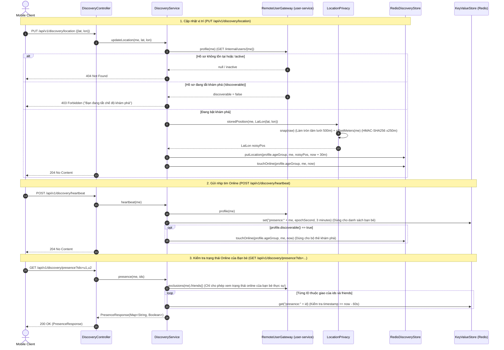
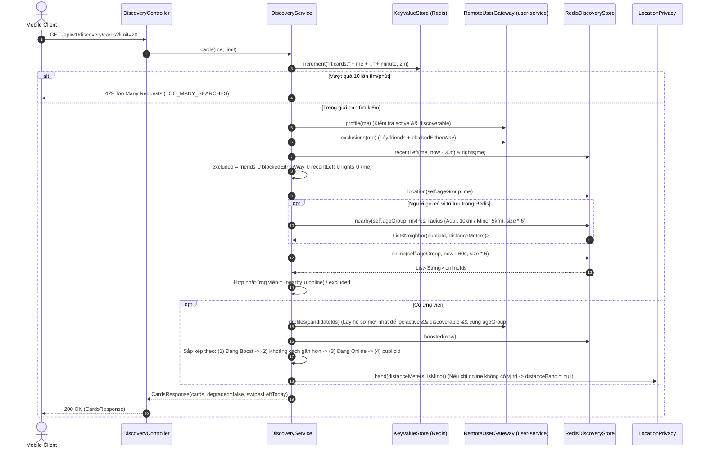
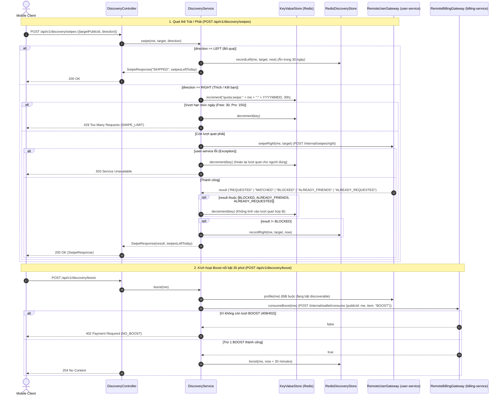

# 05. Kiến trúc `discovery-service` (`com.animallocket.discovery`)

`discovery-service` (`:8104`, Redis GEO/ZSET, không dùng SQL DB) chịu trách nhiệm:
- Bảo vệ quyền riêng tư vị trí bằng cách làm tròn về tâm ô lưới ~500m kết hợp độ lệch cố định theo người dùng bằng `HMAC-SHA256(secret, publicId)` (`±250m`), chỉ trả về dải khoảng cách thô (`LocationPrivacy`).
- Tách biệt hoàn toàn dữ liệu vị trí và trạng thái online theo nhóm tuổi (`geo:ADULT` vs `geo:MINOR`, `online:ADULT` vs `online:MINOR`).
- Xây dựng bộ thẻ quẹt kết hợp **người ở gần (GEO)** HOẶC **đang online (Heartbeat trong 60s)**, loại trừ bạn bè, người bị chặn 2 chiều, người đã quẹt trái (trong 30 ngày) hoặc đã quẹt phải.
- Xử lý quẹt trái/phải có hạn mức (Free 30/ngày, Pro 150/ngày, tự hoàn lượt khi lỗi/đã kết bạn/bị chặn) và kích hoạt `Boost` 30 phút qua `billing-service`.

---

## 1. Class Diagram (`discovery-service`)

```mermaid
classDiagram
    direction TB

    %% ==========================================
    %% Privacy & Store Layer
    %% ==========================================
    class LocationPrivacy {
        <<final>>
        +double CELL_METERS = 500.0$
        +double MAX_OFFSET_METERS = 250.0$
        -byte[] secret
        +snap(LatLon p)$ LatLon
        +storedPosition(String publicId, LatLon raw) LatLon
        ~offsetMeters(String publicId) double[]
        +distanceMeters(LatLon a, LatLon b)$ double
        +band(double meters, boolean minor)$ String
    }
    note for LocationPrivacy "Cơ chế chống định vị tam giác (Anti-trilateration):\n1. Làm tròn toạ độ về tâm ô lưới ~500m.\n2. Cộng độ lệch cố định theo người dùng (HMAC-SHA256) ±250m.\n3. Nhóm MINOR không có mức UNDER_1KM (gộp vào UNDER_3KM)."

    class DiscoveryStore {
        <<interface>>
        +putLocation(String ageGroup, String publicId, LatLon pos, Instant expiresAt) void
        +location(String ageGroup, String publicId) Optional~LatLon~
        +nearby(String ageGroup, LatLon center, double radiusMeters, int limit) List~Neighbor~
        +touchOnline(String ageGroup, String publicId, Instant now) void
        +online(String ageGroup, Instant since, int limit) List~String~
        +onlineStatus(Set~String~ publicIds, Instant since) Map~String, Boolean~
        +boost(String publicId, Instant until) void
        +boosted(Instant now) Set~String~
        +recordLeft(String me, String target, Instant at) void
        +recentLeft(String me, Instant since) Set~String~
        +recordRight(String me, String target, Instant at) void
        +rights(String me) Set~String~
        +removePresence(String publicId) void
        +purgeExpired(Instant now) int
        +forget(String publicId) void
    }
    note for DiscoveryStore "Giao diện lưu trữ trạng thái khám phá.\nTách khoá theo ageGroup để người lớn và trẻ vị thành niên không bao giờ thấy nhau."

    class RedisDiscoveryStore {
        -StringRedisTemplate redis
        +putLocation(...) void
        +nearby(...) List~Neighbor~
        +touchOnline(...) void
        +online(...) List~String~
        +boost(...) void
        +purgeExpired(Instant now) int
        +forget(String publicId) void
    }
    note for RedisDiscoveryStore "Triển khai trên Redis:\n- GEOSET: geo:{ageGroup} + ZSET hạn dùng geo:exp:{ageGroup}\n- ZSET online: online:{ageGroup}\n- ZSET boost: boost\n- ZSET/SET quẹt: swipe:left:{me}, swipe:right:{me}."

    class InMemoryDiscoveryStore {
        +putLocation(...) void
        +nearby(...) List~Neighbor~
    }

    %% ==========================================
    %% S2S Gateways
    %% ==========================================
    class UserGateway {
        <<interface Gateways.UserGateway>>
        +profile(String publicId) Profile
        +profiles(List~String~ publicIds) Map~String, Profile~
        +exclusions(String publicId) Exclusions
        +swipeRight(String from, String to) String
    }

    class RemoteUserGateway {
        <<@Component>>
        -RestClient client
        -CircuitBreakerFactory breakers
        +profile(String publicId) Profile
        +profiles(List~String~ publicIds) Map~String, Profile~
        +exclusions(String publicId) Exclusions
        +swipeRight(String from, String to) String
    }

    class BillingGateway {
        <<interface Gateways.BillingGateway>>
        +consumeBoost(String publicId) boolean
    }

    class RemoteBillingGateway {
        <<@Component>>
        -RestClient client
        -CircuitBreakerFactory breakers
        +consumeBoost(String publicId) boolean
    }

    %% ==========================================
    %% Service, Messaging & Controller
    %% ==========================================
    class DiscoveryService {
        <<@Service>>
        -DiscoveryStore store
        -UserGateway users
        -BillingGateway billing
        -LocationPrivacy privacy
        -KeyValueStore kv
        -Clock clock
        -Duration locationTtl
        -double radiusAdultM
        -double radiusMinorM
        -int cardsPerMinute
        -int swipesFree
        -int swipesPro
        +updateLocation(String me, double lat, double lon) void
        +clearLocation(String me) void
        +heartbeat(String me) void
        +presence(String me, Set~String~ ids) PresenceResponse
        +cards(String me, int limit) CardsResponse
        +swipe(String me, String target, Direction dir) SwipeResponse
        +boost(String me) void
        +forget(String publicId) void
        +setPro(String publicId, Instant expiresAt) void
        +clearPro(String publicId) void
        +purge() int
    }

    class DiscoveryEvents {
        <<@Component>>
        -DiscoveryService discovery
        +onMessage(String json) void
        +purge() void
    }
    note for DiscoveryEvents "Lắng nghe user.events & billing.events (USER_DELETED, DISCOVERY_DISABLED, SUBSCRIPTION_*)\nvà chạy @Scheduled mỗi 60s để dọn các điểm GEO/online hết hạn."

    class DiscoveryController {
        <<@RestController /api/v1/discovery>>
        -DiscoveryService discovery
        +location(String me, LocationRequest req) void
        +clearLocation(String me) void
        +heartbeat(String me) void
        +presence(String me, List~String~ ids) PresenceResponse
        +cards(String me, int limit) CardsResponse
        +swipe(String me, SwipeRequest req) SwipeResponse
        +boost(String me) void
    }
    note for DiscoveryController "Endpoint /cards xử lý Fail-soft: nếu user-service 503 hoặc Redis lỗi\nsẽ trả về CardsResponse([], degraded=true, 0) thay vì làm sập màn hình."

    DiscoveryStore <|.. RedisDiscoveryStore : implements
    DiscoveryStore <|.. InMemoryDiscoveryStore : implements
    UserGateway <|.. RemoteUserGateway : implements
    BillingGateway <|.. RemoteBillingGateway : implements
    DiscoveryController --> DiscoveryService : delegates
    DiscoveryEvents --> DiscoveryService : triggers
    DiscoveryService --> DiscoveryStore : reads/writes GEO & online
    DiscoveryService --> LocationPrivacy : snaps & bands coordinates
    DiscoveryService --> UserGateway : fetches profiles/exclusions/swipes
    DiscoveryService --> BillingGateway : consumes BOOST
```

---

## 2. Sequence Diagrams theo Từng Class (`discovery-service`)

### 2.1 Class `DiscoveryController`, `DiscoveryService` & `LocationPrivacy` — Cập nhật Vị trí, Heartbeat & Truy vấn Online

---

### 2.2 Class `DiscoveryService` & `RedisDiscoveryStore` — Ghép Bộ Thẻ Khám Phá (`GET /api/v1/discovery/cards`)

---

### 2.3 Class `DiscoveryService` & `RemoteBillingGateway` — Quẹt Thẻ (`swipe`) & Kích hoạt `Boost`

