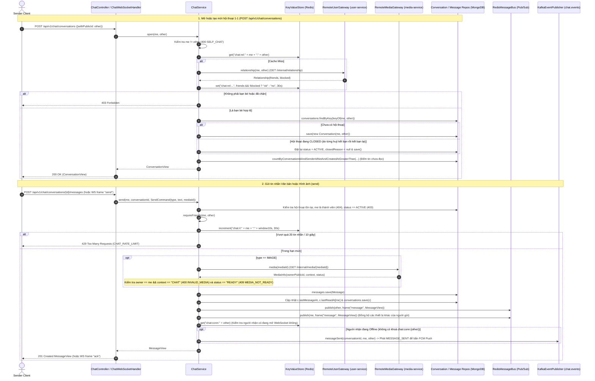
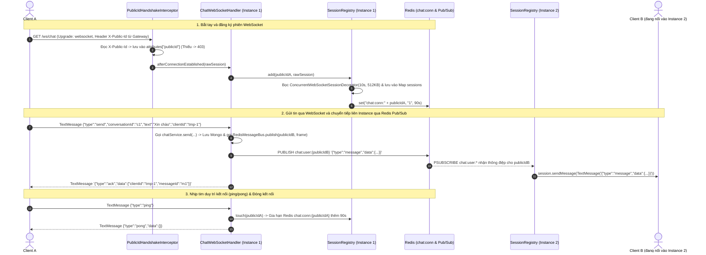
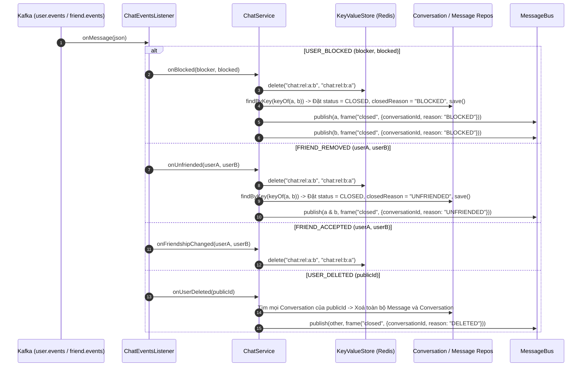

# 06. Kiến trúc `chat-service` (`com.animallocket.chat`)

`chat-service` (`:8105`, MongoDB + Redis Pub/Sub + WebSocket) đảm nhiệm:
- Hội thoại 1-1 giữa bạn bè (`Conversation`) và lưu trữ tin nhắn văn bản/hình ảnh (`Message`) trên MongoDB.
- Xác minh quan hệ bạn bè (`friends && !blocked`) qua `user-service` (cache Redis 30s) và kiểm tra ảnh đính kèm (`context=CHAT && status=READY && cùng chủ`) qua `media-service`.
- Giao tiếp thời gian thực hai chiều qua WebSocket (`/ws/chat`) hỗ trợ nhiều thiết bị và mở rộng ngang nhiều instance nhờ `RedisMessageBus` (`PSUBSCRIBE chat:user:*`) và `SessionRegistry`.
- Chỉ phát sự kiện `MESSAGE_SENT` lên Kafka để gửi thông báo đẩy (FCM Push) khi người nhận **không có phiên WebSocket nào đang mở** (`chat:conn:{recipient}` rỗng).

---

## 1. Class Diagram (`chat-service`)

```mermaid
classDiagram
    direction TB

    %% ==========================================
    %% Domain Documents & Repositories (MongoDB)
    %% ==========================================
    class Conversation {
        <<@Document conversations>>
        -String id
        -String key
        -List~String~ participants
        -Status status
        -String closedReason
        -Instant createdAt
        -Instant lastMessageAt
        -Map~String, Instant~ lastReadAt
        +keyOf(String a, String b)$ String
        +other(String me) String
        +has(String id) boolean
    }
    note for Conversation "Tài liệu hội thoại 1-1.\nKhoá duy nhất key = 'minId:maxId'.\nStatus: ACTIVE | CLOSED (khi BLOCKED, UNFRIENDED, DELETED)."

    class Message {
        <<@Document messages>>
        -String id
        -String conversationId
        -String senderId
        -Type type
        -String text
        -String mediaId
        -Instant createdAt
    }
    note for Message "Tin nhắn thuộc hội thoại (Type: TEXT | IMAGE).\nĐánh compound index {'conversationId': 1, 'createdAt': -1}."

    class ConversationRepository {
        <<interface>>
        +findByKey(String key) Optional~Conversation~
        +findByParticipantsOrderByLastMessageAtDesc(String participant) List~Conversation~
    }

    class MessageRepository {
        <<interface>>
        +findByConversationIdAndCreatedAtLessThanOrderByCreatedAtDesc(String convId, Instant before, Pageable page) List~Message~
        +countByConversationIdAndSenderIdNotAndCreatedAtGreaterThan(String convId, String notSender, Instant after) long
        +deleteByConversationId(String conversationId) void
    }

    %% ==========================================
    %% Pub/Sub Message Bus & WebSocket Layer
    %% ==========================================
    class MessageBus {
        <<interface>>
        +publish(String publicId, String json) void
        +subscribe(BiConsumer~String, String~ deliverLocally) void
    }
    note for MessageBus "Bus phát thông điệp realtime tới mọi instance chat-service."

    class RedisMessageBus {
        -StringRedisTemplate redis
        -RedisMessageListenerContainer container
        +publish(String publicId, String json) void
        +subscribe(BiConsumer~String, String~ deliverLocally) void
    }
    note for RedisMessageBus "PUBLISH lên kênh chat:user:{publicId} và PSUBSCRIBE chat:user:*\nđể chuyển khung JSON tới phiên WebSocket cục bộ."

    class LocalMessageBus {
        -BiConsumer~String, String~ handler
        +publish(String publicId, String json) void
        +subscribe(BiConsumer~String, String~ deliverLocally) void
    }

    class PublicIdHandshakeInterceptor {
        +beforeHandshake(ServerHttpRequest req, ServerHttpResponse res, WebSocketHandler wsHandler, Map attributes) boolean
        +afterHandshake(...) void
    }
    note for PublicIdHandshakeInterceptor "Kiểm tra header X-Public-Id do Gateway gắn ngay lúc bắt tay WebSocket.\nNếu thiếu -> từ chối 403 FORBIDDEN."

    class SessionRegistry {
        -Map~String, Set~WebSocketSession~~ sessions
        -KeyValueStore kv
        +add(String publicId, WebSocketSession raw) WebSocketSession
        +remove(String publicId, WebSocketSession s) void
        +touch(String publicId) void
        +isConnectedAnywhere(String publicId) boolean
        +deliver(String publicId, String json) void
        +localSessionCount() int
    }
    note for SessionRegistry "Quản lý các phiên WebSocket trên instance hiện tại (bọc ConcurrentWebSocketSessionDecorator)\nvà duy trì khoá Redis chat:conn:{publicId} (TTL 90s)."

    class ChatWebSocketHandler {
        -SessionRegistry registry
        -ChatService chat
        +afterConnectionEstablished(WebSocketSession session) void
        #handleTextMessage(WebSocketSession session, TextMessage message) void
        +afterConnectionClosed(WebSocketSession session, CloseStatus status) void
    }
    note for ChatWebSocketHandler "Xử lý các khung lệnh WebSocket từ client: ping, read, send.\nĐóng kết nối nếu khung > 16KB."

    %% ==========================================
    %% Gateways, Service, Listener & Controller
    %% ==========================================
    class UserGateway {
        <<interface Gateways.UserGateway>>
        +relationship(String a, String b) Relationship
    }

    class MediaGateway {
        <<interface Gateways.MediaGateway>>
        +media(String mediaId) MediaInfo
    }

    class EventPublisher {
        <<interface Gateways.EventPublisher>>
        +messageSent(String conversationId, String sender, String recipient) void
    }

    class ChatService {
        <<@Service>>
        -ConversationRepository conversations
        -MessageRepository messages
        -UserGateway users
        -MediaGateway media
        -EventPublisher events
        -MessageBus bus
        -KeyValueStore kv
        -int maxPerWindow
        +open(String me, String other) ConversationView
        +mine(String me) List~ConversationView~
        +send(String me, String conversationId, SendCommand cmd) MessageView
        +history(String me, String conversationId, Instant before, int limit) List~MessageView~
        +markRead(String me, String conversationId) void
        +onBlocked(String a, String b) void
        +onUnfriended(String a, String b) void
        +onFriendshipChanged(String a, String b) void
        +onUserDeleted(String publicId) void
    }

    class ChatEventsListener {
        <<@Component>>
        -ChatService chat
        +onMessage(String json) void
        ~handle(EventEnvelope e) void
    }

    class ChatController {
        <<@RestController /api/v1/chat>>
        -ChatService chat
        +open(String me, OpenRequest req) ConversationView
        +mine(String me) List~ConversationView~
        +history(String me, String id, Instant before, int limit) List~MessageView~
        +send(String me, String id, SendRequest req) MessageView
        +read(String me, String id) void
    }

    MessageBus <|.. RedisMessageBus : implements
    MessageBus <|.. LocalMessageBus : implements
    ChatController --> ChatService : delegates REST
    ChatWebSocketHandler --> ChatService : delegates WS send/read
    ChatWebSocketHandler --> SessionRegistry : manages sessions
    RedisMessageBus ..> SessionRegistry : delivers via callback
    ChatEventsListener --> ChatService : handles Kafka events
    ChatService --> ConversationRepository : persists
    ChatService --> MessageRepository : persists
    ChatService --> UserGateway : checks friendship
    ChatService --> MediaGateway : verifies chat image
    ChatService --> EventPublisher : emits MESSAGE_SENT
    ChatService --> MessageBus : broadcasts frames
```

---

## 2. Sequence Diagrams theo Từng Class (`chat-service`)

### 2.1 Class `ChatController` & `ChatService` — Mở hội thoại, Gửi tin nhắn (Text / Ảnh) & Đồng bộ đa thiết bị

---

### 2.2 Class `PublicIdHandshakeInterceptor`, `ChatWebSocketHandler`, `SessionRegistry` & `RedisMessageBus` — Luồng WebSocket Đa Instance

---

### 2.3 Class `ChatEventsListener` — Đóng hội thoại khi Chặn / Huỷ kết bạn / Xoá tài khoản

