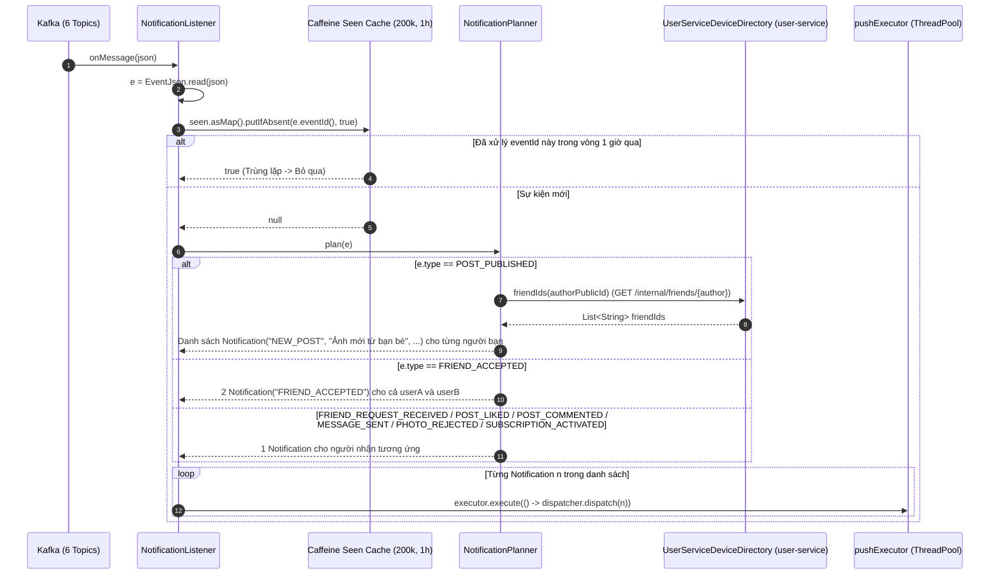
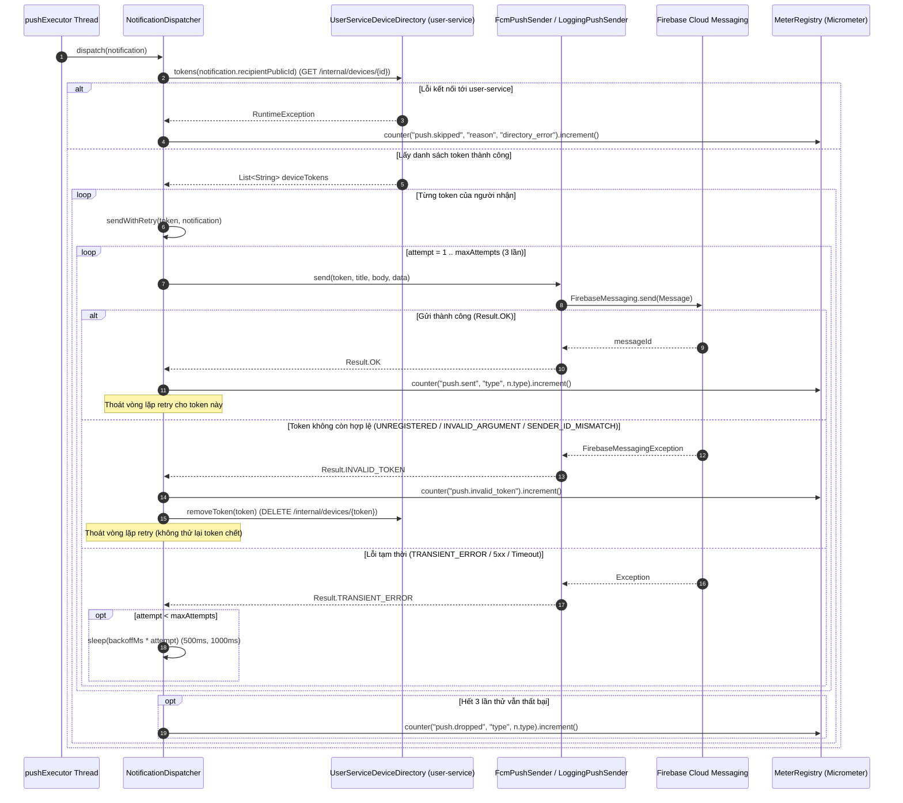

# 07. Kiến trúc `notification-service` (`com.animallocket.notification`)

`notification-service` (`:8107`, Stateless — không dùng Database) chịu trách nhiệm:
- Lắng nghe 6 topic Kafka (`user.events`, `friend.events`, `post.events`, `chat.events`, `media.events`, `billing.events`) và khử trùng lặp trong bộ nhớ bằng Caffeine Cache (`NotificationListener`).
- Chuyển đổi từng sự kiện thành danh sách thông báo đẩy có **nội dung ẩn danh hoàn toàn** (không bao giờ chèn biệt danh, tên thú hay nội dung tin nhắn lên màn hình khoá điện thoại) (`NotificationPlanner`).
- Thực thi gửi FCM Push trên Thread Pool riêng biệt (`ExecutorConfig` — Bulkhead cô lập lỗi), tự động thử lại tối đa 3 lần khi lỗi mạng tạm thời (`TRANSIENT_ERROR`) và tự động gọi `user-service` xoá các token thiết bị đã hết hạn/gỡ cài đặt (`INVALID_TOKEN`) (`NotificationDispatcher`, `FcmPushSender`, `UserServiceDeviceDirectory`).

---

## 1. Class Diagram (`notification-service`)

```mermaid
classDiagram
    direction TB

    class Notification {
        <<record>>
        +String recipientPublicId
        +String type
        +String title
        +String body
        +Map~String, String~ data
    }
    note for Notification "Bản ghi thông báo đẩy chuẩn bị gửi.\nNội dung title/body hoàn toàn chung chung để bảo vệ tính ẩn danh trên màn hình khoá."

    class DeviceDirectory {
        <<interface>>
        +tokens(String publicId) List~String~
        +friendIds(String publicId) List~String~
        +removeToken(String token) void
    }
    note for DeviceDirectory "Cổng giao tiếp lấy danh sách FCM token và danh sách bạn bè từ user-service."

    class UserServiceDeviceDirectory {
        <<@Component>>
        -RestClient client
        +tokens(String publicId) List~String~
        +friendIds(String publicId) List~String~
        +removeToken(String token) void
    }

    class PushSender {
        <<interface>>
        +send(String deviceToken, String title, String body, Map~String, String~ data) Result
    }
    note for PushSender "Kết quả gửi (Result):\n- OK\n- INVALID_TOKEN (UNREGISTERED, INVALID_ARGUMENT, SENDER_ID_MISMATCH)\n- TRANSIENT_ERROR."

    class FcmPushSender {
        <<@Component>>
        -FirebaseMessaging messaging
        +send(String deviceToken, String title, String body, Map~String, String~ data) Result
    }
    note for FcmPushSender "Gửi thông báo thật qua Firebase Admin SDK khi có cấu hình FCM_CREDENTIALS_FILE."

    class LoggingPushSender {
        <<@Component>>
        +send(String deviceToken, String title, String body, Map~String, String~ data) Result
    }
    note for LoggingPushSender "Ghi log giả lập (che token) khi chạy dev/test không có khoá Firebase."

    class ExecutorConfig {
        <<@Configuration>>
        +pushExecutor() Executor
    }
    note for ExecutorConfig "ThreadPoolTaskExecutor riêng (core=4, max=16, queue=5000, DiscardPolicy)\nđể việc gọi FCM chậm không làm nghẽn luồng Kafka Consumer."

    class NotificationPlanner {
        <<@Component>>
        -DeviceDirectory directory
        +plan(EventEnvelope e) List~Notification~
    }
    note for NotificationPlanner "Ánh xạ 8 loại sự kiện Kafka sang danh sách người nhận:\nRiêng POST_PUBLISHED sẽ gọi directory.friendIds(author) để fan-out tới mọi người bạn."

    class NotificationDispatcher {
        <<@Component>>
        -DeviceDirectory directory
        -PushSender sender
        -MeterRegistry metrics
        -int maxAttempts
        -long backoffMs
        -LongConsumer sleeper
        +dispatch(Notification n) void
        -sendWithRetry(String token, Notification n) void
    }
    note for NotificationDispatcher "Thực hiện gửi Push kèm retry luỹ tuyến (500ms * attempt),\nđếm metric Micrometer (push.sent, push.dropped, push.invalid_token)\nvà tự động dọn token chết."

    class NotificationListener {
        <<@Component>>
        -NotificationPlanner planner
        -NotificationDispatcher dispatcher
        -Executor executor
        -Cache~String, Boolean~ seen
        +onMessage(String json) void
    }

    DeviceDirectory <|.. UserServiceDeviceDirectory : implements
    PushSender <|.. FcmPushSender : implements
    PushSender <|.. LoggingPushSender : implements
    NotificationListener --> NotificationPlanner : plans notifications
    NotificationListener --> NotificationDispatcher : submits to pushExecutor
    NotificationPlanner --> DeviceDirectory : queries friendIds
    NotificationDispatcher --> DeviceDirectory : fetches & removes tokens
    NotificationDispatcher --> PushSender : sends FCM message
```

---

## 2. Sequence Diagrams theo Từng Class (`notification-service`)

### 2.1 Class `NotificationListener` & `NotificationPlanner` — Nhận sự kiện Kafka & Lập kế hoạch Thông báo (Fan-out)

---

### 2.2 Class `NotificationDispatcher`, `FcmPushSender` & `UserServiceDeviceDirectory` — Gửi FCM, Retry & Tự động dọn Token chết

