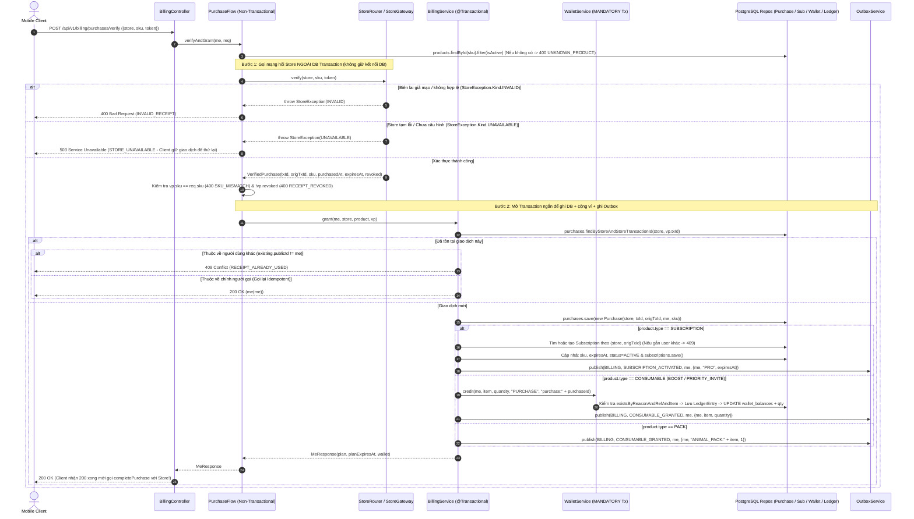
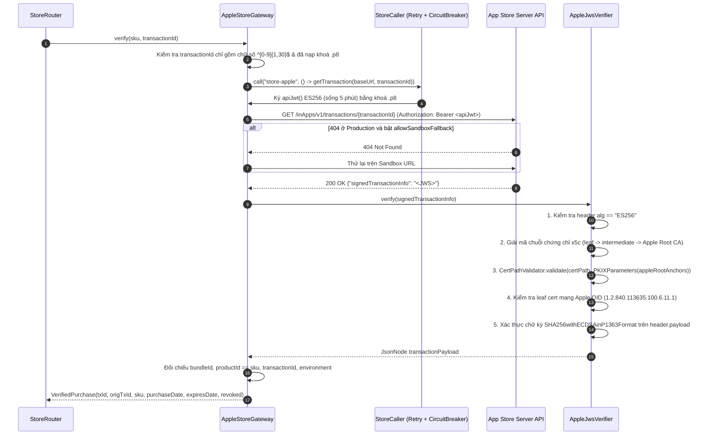
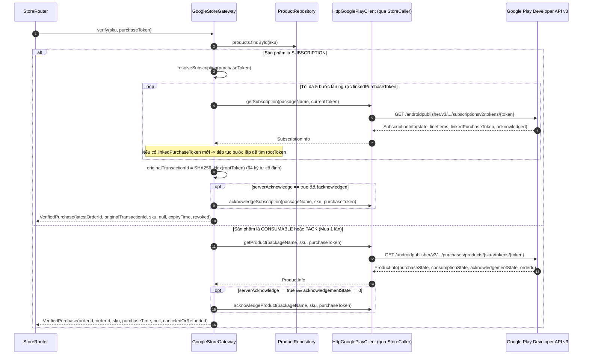
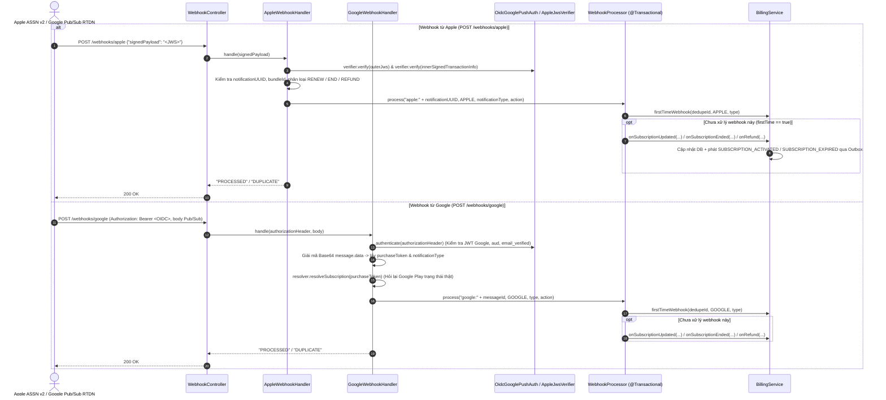

# 08. Kiến trúc `billing-service` (`com.animallocket.billing`)

`billing-service` (`:8106`, PostgreSQL `billing_db`) quản lý toàn bộ nghiệp vụ thương mại hoá theo nguyên tắc **Fail-Closed**:
- Danh mục 8 sản phẩm (`Product`: `SUBSCRIPTION`, `CONSUMABLE`, `PACK`), lịch sử giao dịch (`Purchase`), thuê bao Pro (`Subscription`), ví vật phẩm (`WalletBalance`) và sổ cái bất biến (`LedgerEntry`).
- Tách bạch `PurchaseFlow` (xác thực biên lai qua mạng với Apple/Google **ngoài** transaction DB) và `BillingService.grant()` (ghi DB + cộng ví + phát sự kiện Outbox **trong một transaction ngắn**).
- Xác thực chữ ký JWS `ES256` + chuỗi chứng chỉ PKIX X.509 Apple Root CA G3 (`AppleStoreGateway`, `AppleJwsVerifier`) và gọi Google Play Developer API v3 kèm lần chuỗi `linkedPurchaseToken` (`GoogleStoreGateway`, `HttpGooglePlayClient`).
- Xử lý thông báo gia hạn/hết hạn/hoàn tiền từ Apple ASSN v2 và Google RTDN (`WebhookController`, `AppleWebhookHandler`, `GoogleWebhookHandler`, `WebhookProcessor`) cùng tiến trình nền hạ cấp thuê bao quá hạn (`BillingMaintenance`).

---

## 1. Class Diagram (`billing-service`)

```mermaid
classDiagram
    direction TB

    %% ==========================================
    %% Domain Entities (com.animallocket.billing.domain)
    %% ==========================================
    class Product {
        <<@Entity products>>
        -String sku
        -Type type
        -String item
        -int quantity
        -boolean active
    }
    note for Product "Loại sản phẩm (Type):\n- SUBSCRIPTION (Pro tháng/năm)\n- CONSUMABLE (BOOST, PRIORITY_INVITE)\n- PACK (Gói thú mở khoá vĩnh viễn)."

    class Purchase {
        <<@Entity purchases>>
        -Long id
        -Store store
        -String storeTransactionId
        -String originalTransactionId
        -String publicId
        -String sku
        -Status status
        -Instant createdAt
    }
    note for Purchase "Khoá duy nhất (store, storeTransactionId) chống dùng lại biên lai.\nStatus: GRANTED | REFUNDED."

    class Subscription {
        <<@Entity subscriptions>>
        -Long id
        -String publicId
        -String sku
        -Store store
        -String originalTransactionId
        -Status status
        -Instant expiresAt
        -Instant updatedAt
    }
    note for Subscription "Khoá duy nhất (store, originalTransactionId).\nStatus: ACTIVE | EXPIRED."

    class WalletBalance {
        <<@Entity wallet_balances>>
        -String publicId
        -String item
        -int balance
    }

    class LedgerEntry {
        <<@Entity wallet_ledger>>
        -Long id
        -String publicId
        -String item
        -int delta
        -String reason
        -String ref
        -Instant createdAt
    }
    note for LedgerEntry "Sổ cái bất biến có khoá duy nhất (reason, ref, item)\nđảm bảo không bao giờ cộng hoặc trừ ví 2 lần cho cùng một sự kiện."

    class WebhookEvent {
        <<@Entity webhook_events>>
        -String id
        -String store
        -String type
        -Instant receivedAt
    }

    %% ==========================================
    %% Store Verification Gateways (com.animallocket.billing.store)
    %% ==========================================
    class StoreGateway {
        <<interface>>
        +store() Store
        +verify(String sku, String token) VerifiedPurchase
    }

    class StoreRouter {
        <<@Component>>
        -Map~Store, StoreGateway~ gateways
        +verify(Store store, String sku, String token) VerifiedPurchase
    }
    note for StoreRouter "Định tuyến tới cổng Store tương ứng.\nNếu Store chưa cấu hình -> ném StoreException(UNAVAILABLE) (Fail-closed)."

    class StoreCaller {
        -CircuitBreakerRegistry breakers
        -RetryRegistry retries
        +call(String name, Call~T~ fn) T
    }
    note for StoreCaller "Bọc lời gọi HTTP tới Apple/Google bằng Resilience4j Retry + CircuitBreaker.\nChỉ retry/tính lỗi mạch khi gặp StoreException(UNAVAILABLE)."

    class AppleJwsVerifier {
        -List~X509Certificate~ roots
        -Set~TrustAnchor~ anchors
        -boolean requireAppleOid
        -Clock clock
        +verify(String jws) JsonNode
    }
    note for AppleJwsVerifier "Xác thực JWS ES256 của Apple:\n1. Kiểm tra alg == ES256\n2. Xác thực chuỗi chứng chỉ x5c theo PKIX tới Apple Root CA\n3. Kiểm tra OID 1.2.840.113635.100.6.11.1 trên leaf cert\n4. Kiểm tra chữ ký ECDSA P1363."

    class AppleStoreGateway {
        -AppleProperties props
        -AppleJwsVerifier verifier
        -RestClient http
        -StoreCaller caller
        -PrivateKey apiKey
        +store() Store
        +verify(String sku, String token) VerifiedPurchase
    }

    class GooglePlayClient {
        <<interface>>
        +getSubscription(String packageName, String purchaseToken) SubscriptionInfo
        +getProduct(String packageName, String sku, String purchaseToken) ProductInfo
        +acknowledgeSubscription(String packageName, String sku, String purchaseToken) void
        +acknowledgeProduct(String packageName, String sku, String purchaseToken) void
    }

    class HttpGooglePlayClient {
        -GoogleProperties props
        -RestClient http
        -StoreCaller caller
        -AccessTokenProvider tokens
        +getSubscription(...) SubscriptionInfo
        +getProduct(...) ProductInfo
        +acknowledgeSubscription(...) void
        +acknowledgeProduct(...) void
    }

    class GoogleSubscriptionResolver {
        <<interface>>
        +resolveSubscription(String purchaseToken) Resolved
    }

    class GoogleStoreGateway {
        -GoogleProperties props
        -GooglePlayClient client
        -ProductRepository products
        +store() Store
        +verify(String sku, String token) VerifiedPurchase
        +resolveSubscription(String purchaseToken) Resolved
    }
    note for GoogleStoreGateway "Lần ngược chuỗi linkedPurchaseToken tối đa 5 bước\nvà băm SHA-256 token gốc để tạo originalTransactionId cố định."

    class DevStoreGateway {
        <<@Component>>
        +store() Store
        +verify(String sku, String token) VerifiedPurchase
    }

    %% ==========================================
    %% Services & Web/Webhook Layer
    %% ==========================================
    class WalletService {
        <<@Service>>
        -WalletBalanceRepository balances
        -LedgerRepository ledger
        +credit(String publicId, String item, int qty, String reason, String ref) boolean
        +debit(String publicId, String item, int n, String reason, String ref) boolean
        +balances(String publicId) Map~String, Integer~
        +wipe(String publicId) void
    }

    class PurchaseFlow {
        <<@Service>>
        -ProductRepository products
        -StoreRouter stores
        -BillingService billing
        +verifyAndGrant(String me, VerifyRequest req) MeResponse
    }
    note for PurchaseFlow "Cố ý KHÔNG đánh dấu @Transactional:\nGọi mạng tới Apple/Google trước, xong mới mở transaction ngắn ở BillingService.grant()."

    class BillingService {
        <<@Service>>
        -ProductRepository products
        -PurchaseRepository purchases
        -SubscriptionRepository subscriptions
        -WebhookEventRepository webhooks
        -WalletService wallet
        -OutboxService outbox
        +catalog() List~ProductView~
        +me(String publicId) MeResponse
        +grant(String me, Store store, Product product, VerifiedPurchase vp) MeResponse
        ~refreshEntitlement(String publicId) void
        +consume(String publicId, String item) void
        +firstTimeWebhook(String id, Store store, String type) boolean
        +onSubscriptionUpdated(Store store, String origTxId, Instant expiresAt) boolean
        +onSubscriptionEnded(Store store, String origTxId) boolean
        +onRefund(Store store, String txId) boolean
        +expireDue(Duration grace) int
        +onUserDeleted(String publicId) void
    }

    class BillingMaintenance {
        <<@Component>>
        -BillingService billing
        -IdempotencyService idempotency
        -Duration grace
        +expire() void
        +onUserEvent(String json) void
    }

    class BillingController {
        <<@RestController>>
        -BillingService billing
        -PurchaseFlow flow
        -WalletService wallet
        +products() List~ProductView~
        +me(String me) MeResponse
        +verify(String me, VerifyRequest req) MeResponse
        +consume(ConsumeRequest req) void
        +wallet(String publicId) Map~String, Integer~
    }

    class WebhookController {
        <<@RestController /webhooks>>
        -AppleWebhookHandler apple
        -GoogleWebhookHandler google
        +apple(AppleBody body) Map~String, String~
        +google(String authorization, JsonNode body) Map~String, String~
    }

    class WebhookProcessor {
        <<@Component>>
        -BillingService billing
        +process(String dedupeId, Store store, String type, Runnable action) boolean
    }

    class AppleWebhookHandler {
        <<@Component>>
        -AppleProperties props
        -AppleJwsVerifier verifier
        -WebhookProcessor processor
        -BillingService billing
        +handle(String signedPayload) String
    }

    class GoogleWebhookHandler {
        <<@Component>>
        -GoogleProperties props
        -GooglePushAuth auth
        -GoogleSubscriptionResolver resolver
        -WebhookProcessor processor
        -BillingService billing
        +handle(String authorizationHeader, JsonNode pushBody) String
    }

    StoreGateway <|.. AppleStoreGateway : implements
    StoreGateway <|.. GoogleStoreGateway : implements
    StoreGateway <|.. DevStoreGateway : implements
    GoogleSubscriptionResolver <|.. GoogleStoreGateway : implements
    GooglePlayClient <|.. HttpGooglePlayClient : implements
    StoreRouter --> StoreGateway : routes
    AppleStoreGateway --> AppleJwsVerifier : verifies JWS
    AppleStoreGateway --> StoreCaller : wraps HTTP
    GoogleStoreGateway --> GooglePlayClient : calls Play API
    HttpGooglePlayClient --> StoreCaller : wraps HTTP
    BillingController --> PurchaseFlow : verify
    BillingController --> BillingService : catalog/me/consume
    PurchaseFlow --> StoreRouter : verifies receipt outside tx
    PurchaseFlow --> BillingService : grants inside tx
    BillingService --> WalletService : credits/debits
    WebhookController --> AppleWebhookHandler : delegates
    WebhookController --> GoogleWebhookHandler : delegates
    AppleWebhookHandler --> WebhookProcessor : runs in tx
    GoogleWebhookHandler --> WebhookProcessor : runs in tx
    WebhookProcessor --> BillingService : updates/ends/refunds
    BillingMaintenance --> BillingService : expires & cleans
```

---

## 2. Sequence Diagrams theo Từng Class (`billing-service`)

### 2.1 Class `BillingController`, `PurchaseFlow`, `BillingService` & `WalletService` — Xác thực Biên lai & Cấp Quyền lợi

---

### 2.2 Class `AppleStoreGateway` & `AppleJwsVerifier` — Xác thực Giao dịch App Store Server API & Chuỗi Chứng chỉ PKIX

---

### 2.3 Class `GoogleStoreGateway` & `HttpGooglePlayClient` — Xác thực Giao dịch Google Play API v3 & Chuỗi `linkedPurchaseToken`

---

### 2.4 Class `WebhookController`, `AppleWebhookHandler`, `GoogleWebhookHandler` & `WebhookProcessor` — Xử lý Webhook từ Store

