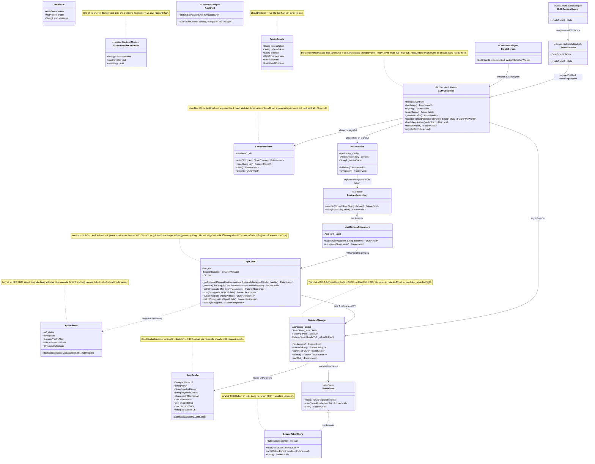
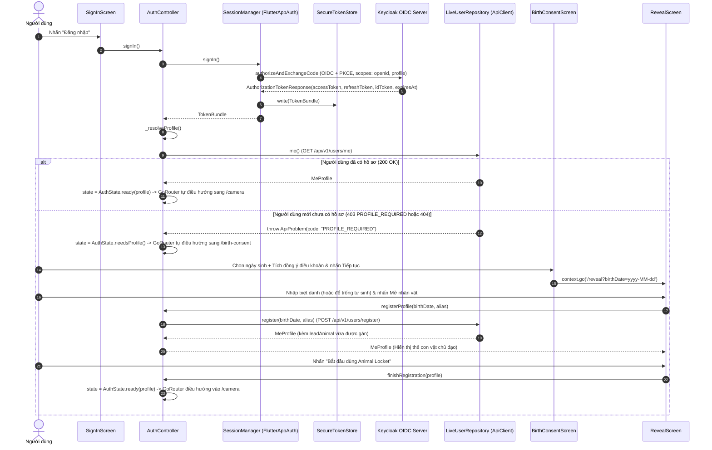
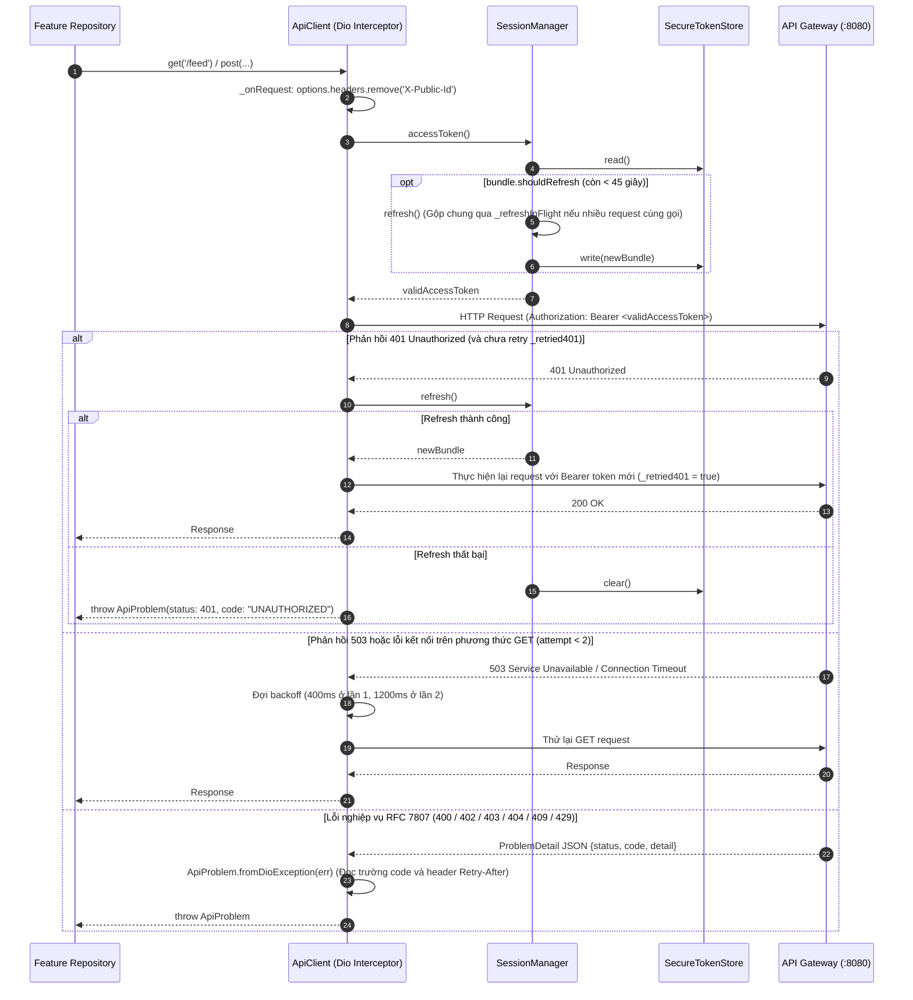
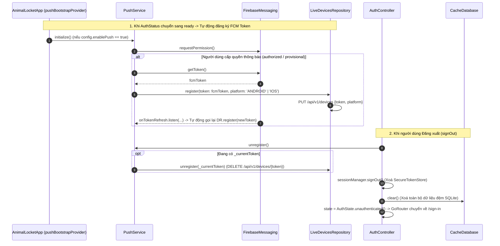

# 09. Kiến trúc Flutter Frontend — Tầng Core, Xác thực OIDC & Thiết bị Push (`mobile/lib/core`, `features/auth`, `features/devices`, `features/shell`)

Tài liệu này mô tả thiết kế lớp (Class Diagram có comment) và sơ đồ tuần tự (Sequence Diagram theo từng class) cho tầng nền tảng của ứng dụng di động Flutter (`mobile/lib/`):
1. **`core/config`, `core/network`, `core/cache`, `core/models`, `core/router`, `core/widgets`**: Cấu hình `--dart-define`, Dio HTTP client (`ApiClient` tự động đính kèm Bearer JWT, xoá `X-Public-Id`, tự làm mới token khi gặp `401` và thử lại `GET` khi `503`), lưu trữ token bảo mật (`SecureTokenStore`), bộ nhớ đệm ngoại tuyến SQLite (`CacheDatabase`), định tuyến bảo vệ theo trạng thái xác thực (`appRouterProvider`).
2. **`core/auth` & `features/auth`**: Luồng đăng nhập OIDC PKCE qua Keycloak (`SessionManager`), quản lý trạng thái phiên & hồ sơ (`AuthController`), và 3 màn hình Onboarding (`SignInScreen`, `BirthConsentScreen`, `RevealScreen`).
3. **`features/devices` & `features/shell`**: Tự động đăng ký/huỷ đăng ký FCM token (`PushService`, `LiveDevicesRepository`) và khung điều hướng 4 tab (`AppShell`).

---

## 1. Class Diagram (`core/`, `auth`, `devices`, `shell`)

---

## 2. Sequence Diagrams theo Từng Class (`core/`, `auth`, `devices`)

### 2.1 Class `SessionManager`, `AuthController`, `SignInScreen`, `BirthConsentScreen` & `RevealScreen` — Luồng Đăng nhập OIDC PKCE & Khởi tạo Hồ sơ

---

### 2.2 Class `ApiClient` & `SessionManager` — Tự động Làm mới Token khi `401` & Thử lại khi `503`

---

### 2.3 Class `PushService`, `LiveDevicesRepository` & `AuthController` — Đăng ký FCM Token & Dọn dẹp khi Đăng xuất

