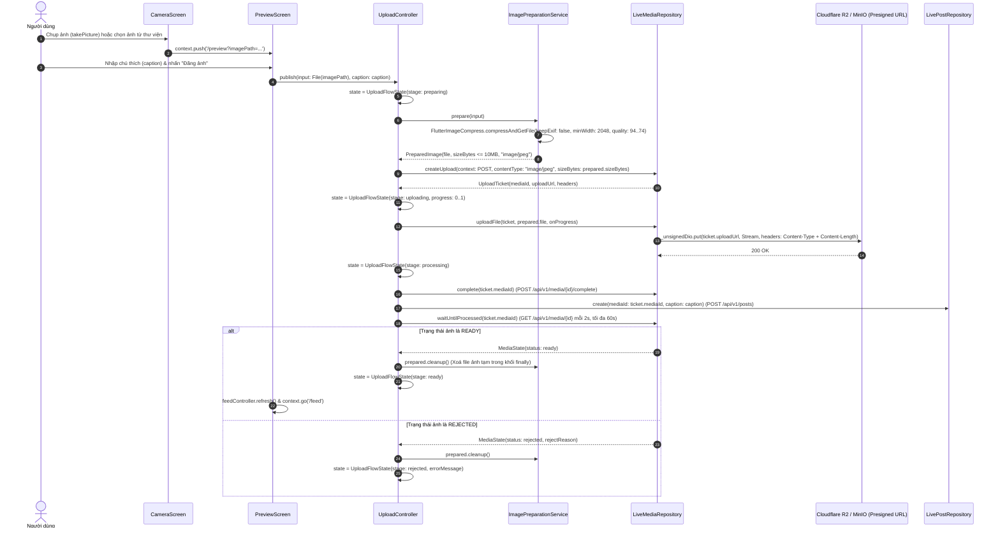
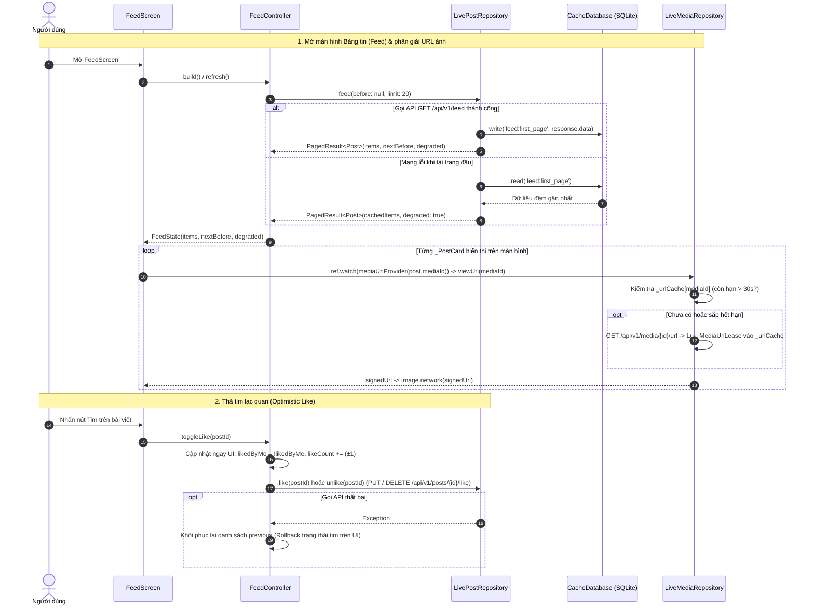
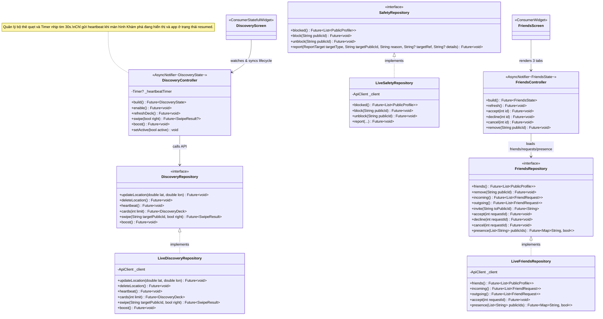
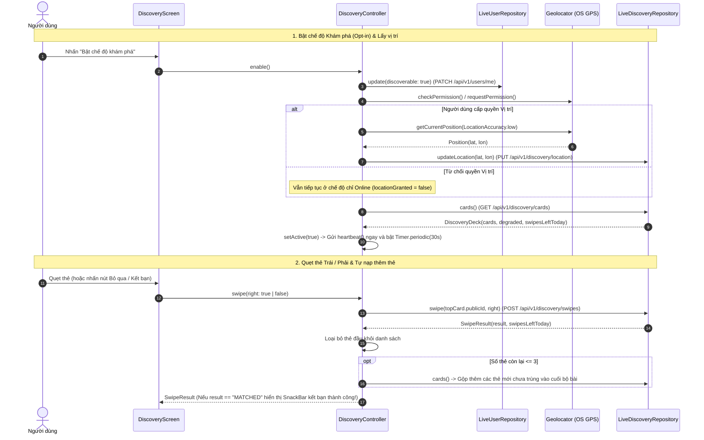
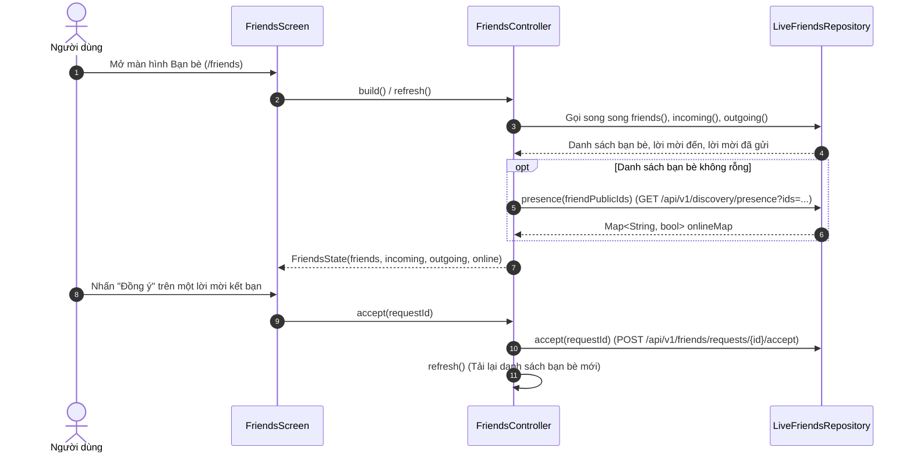
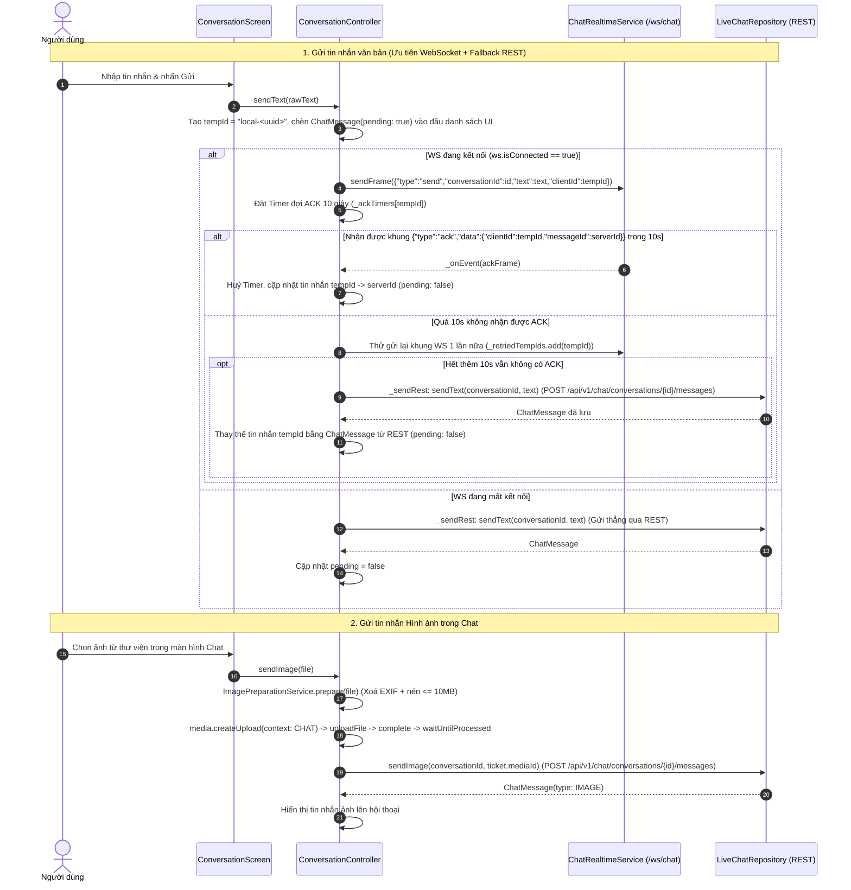
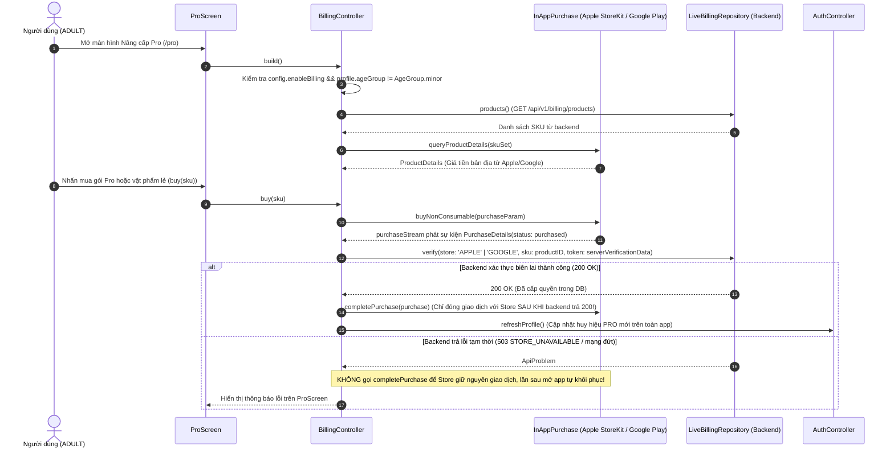

# 10. Kiến trúc Flutter Frontend — 7 Phân hệ Tính năng (`mobile/lib/features/*`)

Tài liệu này mô tả chi tiết thiết kế lớp (Class Diagram có comment) và sơ đồ tuần tự (Sequence Diagram theo từng class) cho 7 phân hệ tính năng chính của ứng dụng di động Flutter (`mobile/lib/features/`):
1. **Camera & Upload (`features/camera`)**: Chụp ảnh, xoá sạch metadata EXIF/GPS & nén JPEG $\le 10\text{ MB}$ (`ImagePreparationService`), xin vé upload, `PUT` trực tiếp lên S3/R2, xác nhận `complete`, tạo bài đăng và đợi xử lý (`UploadController`, `LiveMediaRepository`).
2. **Bảng tin Bạn bè (`features/feed`)**: Phân trang con trỏ `before`, lưu đệm trang đầu vào SQLite, thả tim lạc quan (optimistic like) tự hoàn tác khi lỗi, bình luận và tải URL ảnh có chữ ký kèm bộ nhớ đệm thời hạn (`FeedController`, `LivePostRepository`, `mediaUrlProvider`).
3. **Khám phá Lân cận / Online (`features/discovery`)**: Xin quyền GPS (`Geolocator`), cập nhật vị trí, duy trì nhịp tim `heartbeat` mỗi 30 giây khi tab hiển thị, quẹt thẻ trái/phải, tự nạp thêm thẻ khi còn $\le 3$ thẻ và kích hoạt `Boost` (`DiscoveryController`, `LiveDiscoveryRepository`).
4. **Bạn bè & An toàn (`features/friends`)**: Quản lý danh sách bạn bè kèm chấm xanh online (`presence`), lời mời đến/đã gửi, chặn và báo cáo vi phạm (`FriendsController`, `LiveFriendsRepository`, `LiveSafetyRepository`).
5. **Trò chuyện Thời gian thực (`features/chat`)**: Kết nối WebSocket (`/ws/chat`) tự động kết nối lại theo hàm mũ + gửi `ping` mỗi 45s (`ChatRealtimeService`), gửi tin nhắn lạc quan có timeout 10s và tự động chuyển sang REST (`_sendRest`) khi WebSocket mất kết nối (`ConversationController`, `LiveChatRepository`).
6. **Hồ sơ & Bộ sưu tập Thú (`features/profile`)**: Xem/sửa biệt danh, quay thưởng Gacha, đổi thú chủ đạo (Pro), xem hồ sơ người khác, cài đặt bật/tắt khám phá, bỏ chặn và xoá tài khoản 2 bước (`ProfileController`, `LiveUserRepository`, `ProfileScreen`, `PublicProfileScreen`, `SettingsScreen`).
7. **Nâng cấp Pro & Mua vật phẩm (`features/billing`)**: Tích hợp `InAppPurchase` (StoreKit / Google Play Billing), ẩn hoàn toàn với nhóm `MINOR`, xác thực biên lai với backend **trước** khi gọi `completePurchase` (`BillingController`, `LiveBillingRepository`, `ProScreen`).

---

## Phần 1: Phân hệ Camera & Upload (`features/camera`) và Bảng tin (`features/feed`)

### 1.1 Class Diagram (`features/camera` & `features/feed`)

```mermaid
classDiagram
    direction TB

    %% ==========================================
    %% Camera & Media Upload (features/camera)
    %% ==========================================
    class ImagePreparationService {
        +int maxBytes = 10485760$
        +int targetDimension = 2048$
        +prepare(File input) Future~PreparedImage~
    }
    note for ImagePreparationService "Nén ảnh về tối đa 2048px JPEG với keepExif: false\nđể xoá sạch toạ độ GPS và thông tin thiết bị ngay trên máy khách.\nThử lần lượt chất lượng [94, 88, 82, 74] cho đến khi <= 10MB."

    class PreparedImage {
        +File file
        +int sizeBytes
        +String contentType
        +cleanup() Future~void~
    }

    class MediaRepository {
        <<interface>>
        +createUpload(MediaContext context, String contentType, int sizeBytes, String? refId) Future~UploadTicket~
        +uploadFile(UploadTicket ticket, File file, void Function(UploadProgress)? onProgress) Future~void~
        +complete(String mediaId) Future~MediaState~
        +status(String mediaId) Future~MediaState~
        +viewUrl(String mediaId) Future~MediaUrlLease~
        +waitUntilProcessed(String mediaId, Duration pollInterval, Duration timeout) Future~MediaState~
    }

    class LiveMediaRepository {
        -ApiClient _client
        -Dio _unsignedDio
        -Map~String, MediaUrlLease~ _urlCache
        +createUpload(...) Future~UploadTicket~
        +uploadFile(...) Future~void~
        +complete(String mediaId) Future~MediaState~
        +status(String mediaId) Future~MediaState~
        +viewUrl(String mediaId) Future~MediaUrlLease~
        +waitUntilProcessed(...) Future~MediaState~
    }
    note for LiveMediaRepository "Dùng _unsignedDio riêng (không gắn Bearer JWT của app)\nkhi PUT file trực tiếp lên URL đã ký của Cloudflare R2 / MinIO.\nLưu đệm URL xem ảnh trong _urlCache cho tới trước khi hết hạn 30 giây."

    class UploadController {
        <<Notifier~UploadFlowState~>>
        +build() UploadFlowState
        +reset() void
        +publish(File input, String? caption) Future~void~
    }
    note for UploadController "Điều phối chuỗi 6 bước đăng ảnh:\npreparing -> uploading -> complete -> create post -> waitUntilProcessed -> cleanup."

    class CameraScreen {
        <<ConsumerStatefulWidget>>
    }

    class PreviewScreen {
        <<ConsumerStatefulWidget>>
        +String imagePath
    }

    %% ==========================================
    %% Feed & Posts (features/feed)
    %% ==========================================
    class PostRepository {
        <<interface>>
        +create(String mediaId, String? caption) Future~Post~
        +mine(int limit) Future~List~Post~~
        +feed(DateTime? before, int limit) Future~PagedResult~Post~~
        +delete(String postId) Future~void~
        +like(String postId) Future~void~
        +unlike(String postId) Future~void~
        +comments(String postId, int after, int limit) Future~PagedResult~Comment~~
        +addComment(String postId, String text) Future~Comment~
        +deleteComment(String postId, int commentId) Future~void~
    }

    class LivePostRepository {
        -ApiClient _client
        -CacheDatabase _cache
        +create(...) Future~Post~
        +feed(...) Future~PagedResult~Post~~
        +like(String postId) Future~void~
        +unlike(String postId) Future~void~
        +comments(...) Future~PagedResult~Comment~~
        +addComment(...) Future~Comment~
        +deleteComment(...) Future~void~
    }
    note for LivePostRepository "Lưu trang đầu của Feed vào SQLite (feed:first_page).\nNếu mạng lỗi khi tải trang đầu, tự động đọc lại từ SQLite."

    class FeedController {
        <<AsyncNotifier~FeedState~>>
        +build() Future~FeedState~
        +refresh() Future~void~
        +loadMore() Future~void~
        +toggleLike(String postId) Future~void~
        +deletePost(String postId) Future~void~
    }

    class FeedScreen {
        <<ConsumerStatefulWidget>>
    }

    MediaRepository <|.. LiveMediaRepository : implements
    PostRepository <|.. LivePostRepository : implements
    ImagePreparationService ..> PreparedImage : produces
    UploadController --> ImagePreparationService : strips EXIF & compresses
    UploadController --> MediaRepository : uploads & polls
    UploadController --> PostRepository : creates post
    CameraScreen --> PreviewScreen : navigates with imagePath
    PreviewScreen --> UploadController : triggers publish
    FeedController --> PostRepository : loads feed & toggles like
    FeedScreen --> FeedController : watches state
    FeedScreen --> MediaRepository : resolves viewUrl via mediaUrlProvider
```

### 1.2 Sequence Diagrams theo Từng Class (`features/camera` & `features/feed`)

#### A. Class `CameraScreen`, `PreviewScreen`, `UploadController`, `ImagePreparationService` & `LiveMediaRepository` — Luồng Chụp, Xoá EXIF & Đăng ảnh

#### B. Class `FeedController`, `LivePostRepository` & `LiveMediaRepository` — Tải Feed, Thả tim Lạc quan & Lấy URL Ảnh có Chữ ký

---

## Phần 2: Phân hệ Khám phá (`features/discovery`) & Bạn bè (`features/friends`)

### 2.1 Class Diagram (`features/discovery` & `features/friends`)

### 2.2 Sequence Diagrams theo Từng Class (`features/discovery` & `features/friends`)

#### A. Class `DiscoveryScreen`, `DiscoveryController` & `LiveDiscoveryRepository` — Bật Khám phá, Heartbeat, Quẹt thẻ & Boost

#### B. Class `FriendsScreen`, `FriendsController` & `LiveFriendsRepository` — Tải Bạn bè kèm Trạng thái Online & Xử lý Lời mời

---

## Phần 3: Phân hệ Chat Realtime (`features/chat`), Hồ sơ (`features/profile`) & Nâng cấp Pro (`features/billing`)

### 3.1 Class Diagram (`features/chat`, `features/profile`, `features/billing`)

```mermaid
classDiagram
    direction TB

    %% ==========================================
    %% Chat Realtime & REST (features/chat)
    %% ==========================================
    class ChatSocketAdapter {
        <<interface>>
        +Stream~String~ messages
        +send(String data) void
        +close() Future~void~
    }

    class ChatRealtimeService {
        -AppConfig _config
        -SessionManager _session
        -ChatSocketAdapter? _socket
        -Timer? _pingTimer
        -Timer? _reconnectTimer
        -int _reconnectAttempts
        +Stream~Map~ events
        +bool isConnected
        +connect() Future~void~
        +sendFrame(Map frame) bool
        +disconnect() Future~void~
    }
    note for ChatRealtimeService "Quản lý kết nối WebSocket /ws/chat:\n- Gửi {'type':'ping'} mỗi 45 giây.\n- Khi mất kết nối: tự kết nối lại với Exponential Backoff + Jitter.\n- Phát sóng mọi khung JSON nhận được qua Stream events."

    class ChatRepository {
        <<interface>>
        +conversations() Future~List~Conversation~~
        +createConversation(String participantPublicId) Future~Conversation~
        +messages(String conversationId, DateTime? before, int limit) Future~PagedResult~ChatMessage~~
        +sendText(String conversationId, String text) Future~ChatMessage~
        +sendImage(String conversationId, String mediaId) Future~ChatMessage~
        +markRead(String conversationId) Future~void~
    }

    class LiveChatRepository {
        -ApiClient _client
        -CacheDatabase _cache
        +conversations() Future~List~Conversation~~
        +createConversation(String participantPublicId) Future~Conversation~
        +messages(...) Future~PagedResult~ChatMessage~~
        +sendText(...) Future~ChatMessage~
        +sendImage(...) Future~ChatMessage~
        +markRead(String conversationId) Future~void~
    }

    class ConversationController {
        <<AsyncNotifier~ConversationState~>>
        -Map~String, Timer~ _ackTimers
        -Set~String~ _retriedTempIds
        +build() Future~ConversationState~
        +loadOlder() Future~void~
        +sendText(String rawText) Future~void~
        +sendImage(File file) Future~void~
        -_sendRest(String conversationId, String tempId, String text) Future~void~
        -_onEvent(Map frame) void
    }
    note for ConversationController "Hỗ trợ gửi tin nhắn lạc quan (pending: true):\nƯu tiên gửi qua WebSocket (đợi ACK 10s, retry 1 lần), nếu vẫn timeout hoặc mất WS\nsẽ tự động chuyển sang gọi REST POST /chat/conversations/{id}/messages."

    %% ==========================================
    %% Profile & Settings (features/profile)
    %% ==========================================
    class UserRepository {
        <<interface>>
        +me() Future~MeProfile~
        +register(DateTime birthDate, String? alias) Future~MeProfile~
        +update(String? alias, bool? discoverable) Future~MeProfile~
        +deleteAccount() Future~void~
        +publicProfile(String publicId) Future~PublicProfile~
        +animals() Future~List~Animal~~
        +ownedAnimals() Future~List~String~~
        +spin() Future~SpinResult~
        +setLeadAnimal(String animalCode) Future~MeProfile~
    }

    class ProfileController {
        <<AsyncNotifier~ProfileData~>>
        +build() Future~ProfileData~
        +refresh() Future~void~
        +spin() Future~SpinResult~
        +setLeadAnimal(String animalCode) Future~void~
        +updateAlias(String alias) Future~void~
    }

    %% ==========================================
    %% Billing & IAP (features/billing)
    %% ==========================================
    class BillingRepository {
        <<interface>>
        +products() Future~List~BillingProduct~~
        +verify(String store, String sku, String token) Future~void~
    }

    class LiveBillingRepository {
        -ApiClient _client
        +products() Future~List~BillingProduct~~
        +verify(String store, String sku, String token) Future~void~
    }

    class BillingController {
        <<AsyncNotifier~BillingState~>>
        -StreamSubscription? _sub
        +build() Future~BillingState~
        +buy(String sku) Future~void~
        +restore() Future~void~
        -_onPurchases(List~PurchaseDetails~ purchases) Future~void~
    }
    note for BillingController "Tích hợp StoreKit / Google Play Billing:\n1. Vô hiệu hoá nếu người dùng là MINOR.\n2. Khi nhận PurchaseStatus.purchased/restored: gọi backend verify() TRƯỚC,\nchỉ gọi completePurchase() sau khi backend trả 200 OK."

    ChatRepository <|.. LiveChatRepository : implements
    BillingRepository <|.. LiveBillingRepository : implements
    ChatRealtimeService --> ChatSocketAdapter : wraps WS
    ConversationController --> ChatRealtimeService : sends & listens frames
    ConversationController --> ChatRepository : history & REST fallback
    ProfileController --> UserRepository : loads profile/animals/spin
    BillingController --> BillingRepository : verifies receipt
```

### 3.2 Sequence Diagrams theo Từng Class (`features/chat`, `features/profile`, `features/billing`)

#### A. Class `ConversationController`, `ChatRealtimeService` & `LiveChatRepository` — Gửi Tin nhắn Realtime, Xử lý ACK & Tự động Fallback sang REST

#### B. Class `BillingController`, `LiveBillingRepository` & `ProScreen` — Luồng Mua Gói Pro / Vật phẩm An toàn (Verify-before-Complete)

