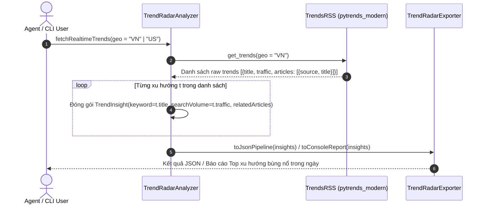
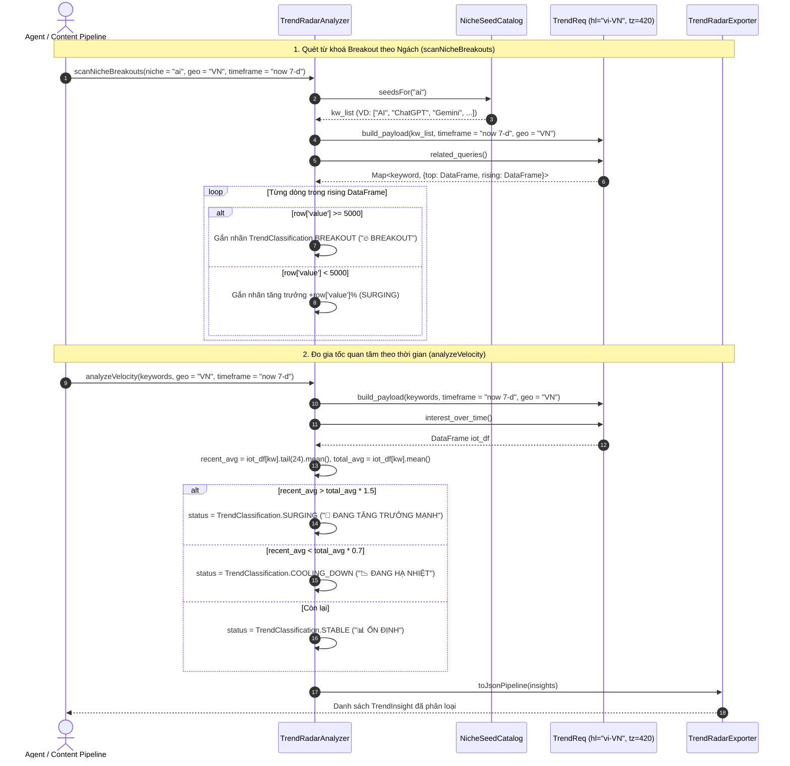

# 11. Kiến trúc Tích hợp `pytrends-modern` (Google Trends Radar & Breakout Analyzer)

Tài liệu này mô tả thiết kế kiến trúc mở rộng cho phân hệ **`pytrends-modern`** (được đề cập trong yêu cầu `//pytrends-modern`) để quét và phân tích các xu hướng tìm kiếm đang bùng nổ trên Google Trends theo thời gian thực (`TrendsRSS`, `TrendReq`), phục vụ gợi ý chủ đề chụp ảnh/chia sẻ khoảnh khắc đang thịnh hành (Trending Prompts / Topic Tags) hoặc sản xuất nội dung bắt trend.

---

## 1. Class Diagram (`pytrends-modern` Integration Architecture)

```mermaid
classDiagram
    direction TB

    class TrendsRSS {
        <<pytrends_modern.TrendsRSS>>
        +get_trends(String geo) List~TrendItem~
    }
    note for TrendsRSS "Lấy Real-Time Trending Searches qua RSS Feed (< 1 giây, không giới hạn rate-limit).\nTrả về tiêu đề xu hướng, lưu lượng tìm kiếm (traffic) và danh sách bài báo liên quan."

    class TrendReq {
        <<pytrends_modern.TrendReq>>
        -String hl
        -int tz
        +build_payload(List~String~ kw_list, String timeframe, String geo) void
        +related_queries() Map~String, DataFrame~
        +interest_over_time() DataFrame
    }
    note for TrendReq "Truy vấn sâu Google Trends:\n- related_queries(): phát hiện từ khoá Rising & Breakout (tăng >= 5000%).\n- interest_over_time(): đo gia tốc quan tâm (Surging vs Cooling Down)."

    class TrendClassification {
        <<enumeration>>
        BREAKOUT
        SURGING
        STABLE
        COOLING_DOWN
    }
    note for TrendClassification "Phân loại cấp độ Trend:\n- BREAKOUT: Tăng >= 5000%\n- SURGING: Tăng +300%..+1000% hoặc recent_avg > 1.5 * total_avg\n- STABLE: Ổn định\n- COOLING_DOWN: recent_avg < 0.7 * total_avg."

    class TrendInsight {
        <<record / DTO>>
        +String keyword
        +String geo
        +String niche
        +int searchVolume
        +int growthPercent
        +TrendClassification classification
        +List~String~ relatedArticles
        +Instant capturedAt
    }

    class NicheSeedCatalog {
        <<final>>
        +Map~String, List~String~~ NICHE_KEYWORDS$
        +seedsFor(String niche) List~String~
    }
    note for NicheSeedCatalog "Danh mục từ khoá hạt giống theo ngách:\nai, tech, finance, entertainment, gaming, ecommerce."

    class TrendRadarAnalyzer {
        -TrendsRSS rssClient
        -TrendReq trendClient
        -NicheSeedCatalog seedCatalog
        +fetchRealtimeTrends(String geo) List~TrendInsight~
        +scanNicheBreakouts(String niche, String geo, String timeframe) List~TrendInsight~
        +analyzeVelocity(List~String~ keywords, String geo, String timeframe) List~TrendInsight~
        -classifyVelocity(double recentAvg, double totalAvg) TrendClassification
    }
    note for TrendRadarAnalyzer "Bộ điều phối trung tâm của pytrends-modern:\nKết hợp quét RSS tốc độ cao và phân tích Breakout/Velocity theo ngách."

    class TrendRadarExporter {
        +toConsoleReport(List~TrendInsight~ insights) String
        +toJsonPipeline(List~TrendInsight~ insights) String
    }

    TrendRadarAnalyzer --> TrendsRSS : fetches real-time RSS
    TrendRadarAnalyzer --> TrendReq : queries rising & velocity
    TrendRadarAnalyzer --> NicheSeedCatalog : resolves niche seeds
    TrendRadarAnalyzer ..> TrendInsight : produces
    TrendInsight --> TrendClassification : typed by
    TrendRadarExporter ..> TrendInsight : formats JSON / CLI
```

---

## 2. Sequence Diagrams theo Từng Class (`pytrends-modern`)

### 2.1 Class `TrendRadarAnalyzer` & `TrendsRSS` — Quét Xu hướng Thời gian thực (Real-time Trends `< 1s`)

---

### 2.2 Class `TrendRadarAnalyzer`, `NicheSeedCatalog` & `TrendReq` — Quét Từ khoá Đột biến (Breakout Queries) & Đo Gia tốc Quan tâm (Search Velocity)

