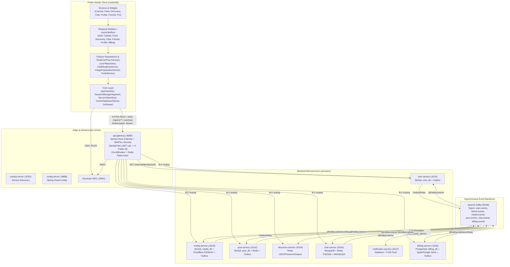

# Tài liệu Kiến trúc Chi tiết: Class Diagram & Sequence Diagram (Backend & Frontend)

Thư mục `docs/architecture/` chứa toàn bộ sơ đồ lớp (**Class Diagram** có chú thích `note` và comment `%%` chi tiết) cùng sơ đồ tuần tự (**Sequence Diagram** phân tách theo từng class và từng phương thức/luồng nghiệp vụ) cho toàn bộ hệ thống **Animal Locket** — bao gồm **Backend Microservices** (`libs/`, `infra/`, `services/`) và **Flutter Mobile Client** (`mobile/lib/`).

> [!NOTE]
> Toàn bộ tài liệu trong thư mục này chỉ mô tả kiến trúc, thiết kế lớp và luồng tương tác tuần tự dựa trên mã nguồn thực tế của dự án, không thay đổi hay sinh thêm mã nguồn thực thi.

---

## 1. Sơ đồ Kiến trúc Tổng thể Hệ thống

---

## 2. Danh mục Tài liệu theo Từng Service & Phân hệ

| STT | File tài liệu | Phạm vi Module / Service | Nội dung chính |
|---|---|---|---|
| 01 | [01-libs-and-infra.md](./01-libs-and-infra.md) | `libs/common`, `libs/outbox-jpa`, `infra/api-gateway`, `infra/config-server`, `infra/eureka-server` | Class Diagram & Sequence Diagram cho các thư viện nền tảng (EventEnvelope, KeyValueStore, ApiExceptionHandler, InternalTokenFilter, Transactional Outbox, Idempotency) và tầng hạ tầng Gateway/Eureka/Config. |
| 02 | [02-user-service.md](./02-user-service.md) | `services/user-service` (`:8101`) | Quản lý danh tính ẩn danh (`publicId`), hồ sơ, bộ sưu tập thú & vòng quay Gacha (`AccountService`, `AnimalCatalog`), kết bạn (`FriendService`), chặn/báo cáo/thiết bị (`SafetyService`), đồng bộ quyền lợi Pro (`EntitlementService`, `BillingEventsListener`) và API nội bộ (`InternalController`). |
| 03 | [03-media-service.md](./03-media-service.md) | `services/media-service` (`:8103`) | Cấp vé presigned PUT lên S3/R2 (`S3ObjectStorage`), xác nhận hoàn tất upload & kiểm tra định dạng/dung lượng (`MediaService`), cấp URL xem ảnh có kiểm tra quan hệ bạn bè (`UserClient`), dọn job treo (`MediaJanitor`), lắng nghe sự kiện (`MediaEventsListener`). |
| 04 | [04-post-service.md](./04-post-service.md) | `services/post-service` (`:8102`) | Đăng bài viết, bảng tin bạn bè (Feed), thích, bình luận (`PostService`), quản lý hạn mức ảnh/ngày theo múi giờ Việt Nam (`QuotaService`), cache danh sách bạn 2 tầng Redis + hồ sơ Caffeine (`UserDirectory`), đồng bộ trạng thái ảnh (`PostEventsListener`). |
| 05 | [05-discovery-service.md](./05-discovery-service.md) | `services/discovery-service` (`:8104`) | Làm mờ toạ độ lưới 500m + nhiễu HMAC cố định (`LocationPrivacy`), lưu trữ Redis GEO & Online (`RedisDiscoveryStore`), ghép bộ thẻ quẹt lân cận/online, xử lý quẹt trái/phải và kích hoạt Boost (`DiscoveryService`, `DiscoveryController`, `DiscoveryEvents`). |
| 06 | [06-chat-service.md](./06-chat-service.md) | `services/chat-service` (`:8105`) | Hội thoại 1-1 trên MongoDB, gửi tin nhắn văn bản & ảnh, kiểm tra quyền bạn bè/rate-limit (`ChatService`), WebSocket thời gian thực đa phiên/đa instance qua Redis Pub/Sub (`ChatWebSocketHandler`, `SessionRegistry`, `RedisMessageBus`), xử lý sự kiện chặn/huỷ kết bạn (`ChatEventsListener`). |
| 07 | [07-notification-service.md](./07-notification-service.md) | `services/notification-service` (`:8107`) | Lắng nghe sự kiện từ 6 topic Kafka (`NotificationListener`), lập kế hoạch thông báo ẩn danh (`NotificationPlanner`), gửi push bất đồng bộ kèm retry/backoff & tự xoá token chết (`NotificationDispatcher`, `FcmPushSender`, `UserServiceDeviceDirectory`). |
| 08 | [08-billing-service.md](./08-billing-service.md) | `services/billing-service` (`:8106`) | Xác thực biên lai ngoài transaction (`PurchaseFlow`), cấp thuê bao Pro / vật phẩm lẻ / gói thú (`BillingService`), ví nguyên tử & sổ cái (`WalletService`), cổng xác thực Apple JWS ES256 & Google Play API v3 (`AppleStoreGateway`, `GoogleStoreGateway`), xử lý Webhook RTDN/ASSN v2 (`WebhookController`, `WebhookProcessor`). |
| 09 | [09-frontend-core-and-auth.md](./09-frontend-core-and-auth.md) | `mobile/lib/core`, `features/auth`, `features/devices`, `features/shell` | Kiến trúc tầng Core Flutter (`ApiClient`, `SessionManager`, `SecureTokenStore`, `AuthController`, `CacheDatabase`, `AppRouter`), luồng đăng nhập OIDC PKCE & đăng ký tuổi/biệt danh (`SignInScreen`, `BirthConsentScreen`, `RevealScreen`) và đăng ký FCM Push (`PushService`). |
| 10 | [10-frontend-features.md](./10-frontend-features.md) | `mobile/lib/features/{profile,camera,feed,discovery,friends,chat,billing}` | Class Diagram & Sequence Diagram chi tiết cho 7 phân hệ tính năng trên ứng dụng Flutter: Hồ sơ & Vòng quay, Camera & Xoá EXIF/Upload, Bảng tin (Feed), Khám phá (Discovery), Bạn bè & An toàn, Chat Realtime (WS + REST fallback), và Nâng cấp Pro (In-App Purchase). |
| 11 | [11-pytrends-modern-integration.md](./11-pytrends-modern-integration.md) | Kiến trúc tích hợp `pytrends-modern` (Trend Radar) | Thiết kế kiến trúc mở rộng cho module quét và phân tích xu hướng Google Trends (`TrendsRSS`, `TrendReq`, `TrendRadarService`) phục vụ gợi ý chủ đề/nội dung thịnh hành. |

